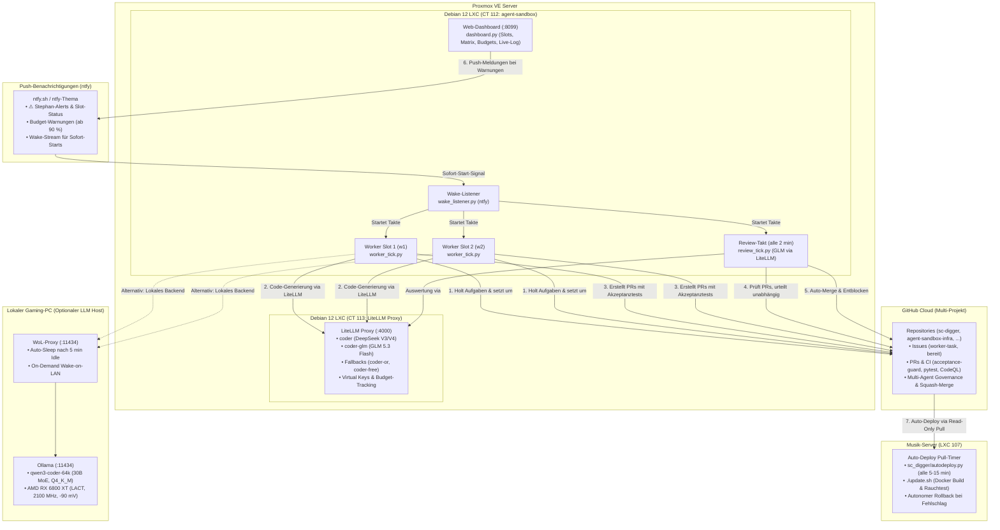

# 🤖 Agent-Sandbox-Infra

> **Autonome Multi-Agenten-Infrastruktur mit Proxmox LXC, isolierten parallelen Worker-Slots, automatischem Review- und Merge-Takt, LiteLLM-Budgetüberwachung, On-Demand WoL LLM-Host und autarkem Web-Dashboard mit ntfy-Push-Benachrichtigungen.**

---

## 🏛️ Architektur-Übersicht



---

## 🚀 Die 5 Ausbaustufen (Roadmap-Status)

Details und Verträge: [`ROADMAP.md`](ROADMAP.md).

| Stufe | Bezeichnung | Status | Kernmerkmale |
|:---:|---|:---:|---|
| **1** | **Autonomer Auto-Merge & Entblockierung** | ✅ **Live** | `review_tick.py` mergt PRs nach unabhängigem Freigabe-Urteil und grünem CI autonom per Squash-Merge (`gh pr merge --squash`); entblockt Folge-Issues (`Wartet auf: #X, #Y`). |
| **2** | **Strukturierte Slot-Telemetrie & HA-Dashboard** | ✅ **Live** ([#14](https://github.com/tripitest-art/agent-sandbox-infra/issues/14), PR [#48](https://github.com/tripitest-art/agent-sandbox-infra/pull/48)) | Atomare Statusdateien (`slot-1.json`, `slot-2.json`) in `/run/worker-slots/`, PID-Überwachung (Dead-PID Detection), reaktiver Webhook-Stream und Mushroom-Karten mit Live-Task, Modell, Laufzeit-Timer und GitHub-Direktlinks. |
| **3** | **Continuous Deployment (Pull-Timer auf CT 112)** | ✅ **Live** ([#15](https://github.com/tripitest-art/agent-sandbox-infra/issues/15)) | `autodeploy.py` prüft alle 15 Minuten `origin/main`, testet einen neuen Stand mit pytest, rollt ihn per `install.sh` aus und setzt bei Fehlern automatisch auf den letzten laufenden Stand zurück. Wartet, solange Worker oder Review arbeiten. Aus, bis `AUTODEPLOY=1` gesetzt ist; Betrieb: [`docs/autodeploy.md`](docs/autodeploy.md). |
| **4** | **Prime-Time & Kosten-intelligentes Scheduling** | ⏳ **Geplant** ([#16](https://github.com/tripitest-art/agent-sandbox-infra/issues/16)) | Dynamisches Umschalten von LiteLLM-Modellen anhand von DeepSeek Prime-Time Tarifen (Peak 1,20 $/1M vs. Off-Peak 0,60 $/1M), automatische Drosselung bei Budgetannäherung. |
| **5** | **Planer-Beschleunigung (AI Issue Pre-Flight)** | ⏳ **Geplant** ([#17](https://github.com/tripitest-art/agent-sandbox-infra/issues/17)) | Automatisierte Akzeptanztest-Validierung (Rot-Prüfung vor Issue-Freigabe), automatische Hotspot- und Abhängigkeitserkennung für den Planer. |

---

## 📁 Repository-Struktur

| Verzeichnis | Beschreibung |
|---|---|
| [`ROADMAP.md`](ROADMAP.md) | Roadmap und 5-Stufen-Optimierungsplan für den autonomen Multi-Agenten-Workflow. |
| [`CHANGELOG.md`](CHANGELOG.md) | Was seit dem letzten Deploy neu ist; eine Zeile pro Pull Request. |
| [`AGENTS.md`](AGENTS.md) | Verbindliche Einweisung und Governance-Regeln für alle KI-Agenten (Planer, Worker, Reviewer). |
| [`SECURITY.md`](SECURITY.md) | Meldeweg für Sicherheitslücken: GitHub „Private vulnerability reporting“; keine Zugangsdaten in öffentliche Issues. |
| [`LICENSE`](LICENSE) | MIT-Lizenz, Copyright (c) 2026 Stephan Voigt. |
| [`docs/`](docs/) | Vertiefende Dokumentation: [`planer-ablauf.md`](docs/planer-ablauf.md), [`mcp.md`](docs/mcp.md), [`mehrere-projekte.md`](docs/mehrere-projekte.md), [`backup.md`](docs/backup.md), [`autodeploy.md`](docs/autodeploy.md), [`betriebsbericht-2026-10-15.md`](docs/betriebsbericht-2026-10-15.md), GitHub Ruleset [`main-schutz.ruleset.json`](docs/main-schutz.ruleset.json). |
| [`skills/`](skills/) | Agenten-Skills für dieses Projekt (`agent-sandbox-review`). |
| [`.github/`](.github/) | CI (`tests`, `acceptance-guard`), Issue- und PR-Vorlagen. Änderungen hier braucht Stephans Freigabe (`freigabe-geschützt`). |
| [`sandbox/`](sandbox/) | Steuerungslogik: Setup (`install.sh`, `install-lib.sh`), Worker-Takt (`worker_tick.py`), Review-Takt (`review_tick.py`), Einstellungsdatei (`agent_settings.py`), Multi-Projektverwaltung (`projects.py`), Auto-Deploy (`autodeploy.py`, Timer `agent-sandbox-deploy` über `AUTODEPLOY=1`), Web-Dashboard (`dashboard.py`, Push-Meldungen in `dashboard_notify.py`, Review-Statistik in `dashboard_stats.py`, nur lesend, nur LAN, Dienst `agent-dashboard` über `DASHBOARD=1`), Wake-Listener (`wake_listener.py`, Dienst `agent-wake`) und systemd-Units (`sandbox/systemd/`). |
| [`proxmox/`](proxmox/) | Host-Skripte zur Erstellung des unprivilegierten Debian 12 LXC-Containers auf Proxmox VE (`host-create.sh`). |
| [`hardware/`](hardware/) | AMD RDNA2 GPU-Tuning für den lokalen LLM-Host (LACT, 2100 MHz, −90 mV, 255 W) mit Benchmarks und Ollama-Overrides. |
| [`tests/`](tests/) | Testsuite für Worker-, Review- und Dashboard-Logik, Multi-Projekte und `acceptance_guard.py` (ohne Netzwerk mit Mocks). |

---

## ⚙️ Funktionsweise im Detail

### 1. Parallele Worker-Slots & Regel-8-Schutz
- **Worktree-Isolation:** Mit `MAX_WORKERS=2` arbeitet jeder Slot in einem komplett isolierten Verzeichnis (z. B. `/root/sc-digger-worktrees/w1` und `/root/sc-digger-worktrees/w2`).
- **Dateikollisionsschutz (Regel 8):** Der Taktgeber liest vor Auftragsannahme alle aktiven Aufgaben. Hat ein Issue Überschneidungen in `### Betroffene Dateien` mit einer bereits laufenden Aufgabe oder berührt die Sperrdatei des Projekts (`hotspot`, z. B. `sc_digger/main.py` mit `hotspot_label = berührt-main.py` für `sc-digger` oder `sandbox/worker_tick.py` mit `hotspot_label = berührt-worker_tick.py` für dieses Repo in [`sandbox/projects.example.json`](sandbox/projects.example.json)), wird es übersprungen, bis der andere Slot fertig ist (Logzeile bei Treffer: `berührt … während bereits ein Auftrag … in Arbeit ist`). Seit #58 fällt Regel 8 nicht mehr offen aus („unbekannt = blockieren“): `parse_affected_files()` liefert `None` statt `set()`, wenn die Sektion `Betroffene Dateien` fehlt oder leer ist (Dateien ohne Endung wie `Dockerfile` und Verzeichnisse wie `sandbox/` werden erkannt); scheitert die Abfrage der aktiven Aufträge (`active_in_progress_issues()` gibt `None`), startet kein Auftrag; ein Kandidat ohne belegte Dateiliste wird mit Logzeile übersprungen.
- **Modell-Fallback:** Vor jedem Lauf prüft der Worker mit einem Mini-Probe-Call das primäre Modell (`coder`, DeepSeek). Antwortet es nicht innerhalb des Timeouts, weicht er automatisch auf konfiguierte Alternativen aus (`coder-or` via OpenRouter, `coder-free` via Codestral).
- **LiteLLM-Ausfall (#180):** Antwortet der Proxy länger als 20 Minuten nicht, schreibt der erste Slot genau eine `⚠ Stephan:`-Zeile („LiteLLM seit N Minuten nicht erreichbar; Worker und Review stehen“), und die Rückkehr steht ohne „⚠“ im Log; ein kurzer Aussetzer bleibt still.
- **Aufräumen der Belegung (#170):** Zu Beginn jedes Laufs löscht `cleanup_claims()` in `CLAIM_DIR` `.done`-Marken und `.claim`-Dateien nicht mehr lebender Prozesse, sobald sie älter als `CLAIM_MAX_AGE_DAYS` (30 Tage) sind; junge Dateien, fremde Endungen, Unterverzeichnisse und Belegungen lebender Prozesse bleiben, und gelöschte Dateien erscheinen als `<n> alte Belegungsdateien aufgeräumt.` im Log.
- **Branch- und Testvorbereitung durch den Takt (#171):** Vor dem Start des Agenten legt `prepare_issue_branch()` in `WORKDIR` den Branch `feature/issue-<N>` an (setzt bestehende Remote- oder lokale Zweige fort bzw. zweigt von `origin/main` ab) und sichert den Akzeptanztest-Block aus dem Issue zeichengenau als ersten Commit (`tests/acceptance/test_issue_<N>.py`). Liefert `acceptance_block()` keinen Block, unterbricht der Takt mit einer `⚠ Stephan:`-Zeile („Akzeptanztest-Block“), ohne den Agenten zu starten.
- **Push und Pull Request durch den Takt (#172):** Nach dem Agentenlauf übernimmt `open_pr()`: Liegen laut `git rev-list --count` Änderungen über den Akzeptanztest-Commit hinaus vor und existiert noch kein offener PR, pusht der Takt auf `origin` (der `pre-push`-Hook prüft die Tests; bei Ablehnung erfolgt ein Alarm und kein PR), baut mit `build_pr_body()` den PR-Text aus der Vorlage und den Commit-Nachrichten und legt den Pull Request über `gh pr create` an.
- **Tagesbudget des Worker-Keys (`key_info`/`budget_problem`):** Vor der Modellprobe liest der Takt `GET {LITELLM}/key/info` mit dem eigenen Schlüssel. Ist das Budget aufgebraucht (`spend >= max_budget`), beantwortet LiteLLM auch die Ausweichmodelle mit 429 – der Takt wartet dann, ohne einen Versuch zu verbrauchen, und läuft nach dem Reset von selbst weiter; die Zeile nennt nur den Reset-Zeitpunkt, keine Budgetwerte. Eine unklare Lage (keine Antwort, kein Limit, keine Zahlen) hält den Takt nicht an.
- **Push-Sperre (`pre-push`-Hook):** Vor jedem Agentenlauf schreibt `worker_tick.py` einen `pre-push`-Hook in den Klon des Slots (`ensure_pre_push_hook`, Ordner von `git rev-parse --git-path hooks`). Er führt `TEST_CMD` aus und lehnt den Push bei roten Tests ab. Nur die Eskalation mit Draft-PR darf `git push --no-verify` nutzen; der Auftrag sagt das ausdrücklich. Scheitert das Setzen des Hooks, startet der Lauf nicht (Meldung `⚠ Stephan:`).
- **`gh`-Fehler mit festem Grund (#161):** `worker_tick.py` und `review_tick.py` erkennen am `gh`-Fehler, ob das Rate-Limit erreicht ist, der Token ungültig oder abgelaufen ist oder GitHub nicht erreichbar ist (`gh_fehler_grund`); die `⚠ Stephan:`-Zeile nennt diesen Klartext und nie den Text aus dem `gh`-Fehler (Regel 5). Der Worker meldet denselben Grund je Slot nur einmal und erst nach einem Lauf ohne `gh`-Fehler wieder; ein Rate-Limit beendet den Review-Lauf, statt für die übrigen Projekte weiter Kontingent zu verbrauchen.
- **Roter `main` (#168):** Bevor der Takt ein neues Issue zum Auftrag macht, fragt er den jüngsten abgeschlossenen Lauf des Workflows `tests` auf `main` ab (`gh run list --workflow tests --branch main --status completed --limit 1`). Ist er rot, entstehen keine neuen Issue-Aufträge, und je Commit erscheint eine `⚠ Stephan:`-Zeile. Nacharbeit an offenen PRs und PR-Text-Aufträge laufen weiter, weil eine Nacharbeit gerade die Reparatur sein kann; sie fragen `main` nie ab, und ohne Issue-Kandidat entfällt die Abfrage ganz. Ein gescheiterter `gh`-Aufruf blockiert nicht, sondern hinterlässt nur `Warnung: Zustand von main nicht abfragbar (<Klasse>).`, damit ein defektes `gh run list` die Pipeline nicht stilllegt.
- **Verwaiste Aufträge (#183):** Steht ein Issue seit mindestens 40 Minuten auf `in-arbeit`, ohne offenen PR auf `feature/issue-<N>` und ohne lebende Belegung, meldet das der erste Slot einmal je Issue als `⚠ Stephan:`-Zeile („Issue #N steht seit M Minuten auf in-arbeit, ohne Lauf und ohne PR; Label prüfen“); Labels bleiben unberührt, der Merker `_verwaist:<N>` verschwindet, sobald das Issue nicht mehr verwaist ist, und ein gescheiterter `gh`-Aufruf hinterlässt nur eine Warnung ohne „⚠“.
- **Erledigte Parkmarken und Leerlauf-Telemetrie (#187):** Ist ein geparkter Auftrag erledigt (PR gemergt oder geschlossen, Issue geschlossen), entfernt der Takt vor der Auswahl die Marke `_park:<skey>` und den Versuchszähler und protokolliert `<skey>: erledigt, Parkmarke entfernt.` — sonst meldete der Slot endlos „`<skey>`: wartet auf Stephan“ (Fall `pr277` nach dem Merge am 14.10.). Im Leerlauf nennt die Slot-Telemetrie zusätzlich die von Regel 8 übersprungenen Kandidaten („Übersprungen (N): #329: Datei-Kollision mit aktivem Auftrag auf …; #349: …“, höchstens drei, dann `+K weitere`); ein `gh`-Fehler, eine unlesbare Antwort oder ein unbekannter Zustandsschlüssel lässt die Marke stehen (im Zweifel geparkt).
- **Audit-Log (`AUDIT_LOG`, Vorgabe `/root/audit.jsonl`; #85):** `worker_tick.py` hängt je Ereignis eine JSON-Zeile an — Zeitstempel in UTC, `event`, Slot, Modell und die übergebenen Felder — damit sich Takte maschinell auswerten lassen, ohne den Fließtext in `/root/worker.log` zu parsen. `model` ist der Ollama-Name, `active_model` das tatsächlich genutzte Modell (mit `BACKEND=litellm` der Alias des Laufs, nach dem Ausweichen also z. B. `coder-free`; #147). Den Anfang macht die Übernahme eines Issues (`issue_claimed`, Funktion `audit()`); Felder wie `token`, `api_key` oder `authorization` stehen nur als `***` drin (Regel 5). Schreibfehler brechen den Lauf nicht ab, sondern kommen als `Audit-Log nicht schreibbar: <Fehlerklasse>` ins Log. Seit #178 stehen auch die Kosten darin: `run_started`/`run_finished` je Agentenlauf, `run_cost` einen Takt später aus der Differenz des `spend` in `GET /key/info` (`parallel`, wenn ein anderer Slot im selben Zeitraum lief — dann ist der Wert eine Obergrenze) und `review_posted` je gepostetem Review mit `kosten` aus `usage["cost"]` der Modellaufrufe.
- **Einstellungsdatei (`/etc/agent-settings.json`, `agent_settings.py`; #164):** `worker_tick.py` und `review_tick.py` lesen unkritische Werte beim Start jedes Laufs aus einer kleinen JSON-Datei (Pfad über `AGENT_SETTINGS`, Vorgabe `/etc/agent-settings.json`): `REVIEW_MAX_TOKENS`, `REVIEW_LLM_TIMEOUT`, `MAX_ROUNDS`, `MAX_TRIES`, `MISSING_CHECK_GRACE_S` und `REVIEW_MODEL_BIG`. Die Datei gewinnt vor der Umgebungsvariable, die Umgebung vor der Vorgabe im Code; ungültige oder unbekannte Einträge werden ignoriert, die Takte starten immer. Weil jeder Lauf ein eigener Prozess ist, gilt eine Änderung ab dem nächsten Takt, ohne Neustart. Die feste Liste schützt die Aufsicht: `REVIEW_MODEL`, `REVIEWER_NAME`, `auto_merge`, `manual_paths`, Timer-Intervalle und alles mit Schlüsseln, Tokens oder Pfaden sind nicht enthalten und nicht ergänzbar. `agent_settings.aktuelle_werte()` nennt Wert und Quelle je Eintrag (Grundlage für die Oberfläche in Teil 2), `agent_settings.save()` prüft und schreibt die Datei atomar.

### 2. Autonomer Review-Takt & Auto-Merge
- `review_tick.py` läuft alle 2 Minuten als unabhängiger systemd-Timer (`REVIEW_TAKT`); ein Modellaufruf entsteht nur für einen neuen Commit.
- **Sofort-Start statt Warten:** `.github/workflows/wake.yml` schickt bei Label `bereit`, PR-Ereignissen und fertigen Checks das Wort „wake“ an einen ntfy-Strom (GitHub-Secret `WAKE_PUBLISH_URL`, Inhalt und Thema nie im Repo). Der Dienst `agent-wake` auf dem Server hört dort ausgehend mit und startet die Takt-Units sofort (Teil 1: #128). Die Timer bleiben als Sicherheitsnetz.
- **Unabhängiges Modell:** Reviews werden mit `coder-glm` (GLM 5.3 Flash) durchgeführt – strikt getrennt von der Worker-Modellfamilie (Anzeige beim Deploy: `Review-Takt: an (…, coder-glm, …)`). Die zuvor für große Diffs genannte Option `longctx-lite` hatte keine belegte Modellfamilie, wodurch der Review-Takt sich selbst blockierte (behoben mit PR #57); aktuell läuft alles einheitlich mit `coder-glm`.
- **Ausweichen bei unbrauchbarer Antwort:** Liefert das aufgerufene Modell nichts Verwertbares (Antwort ans Token-Limit gestoßen, kein Urteil, ungültige Muss/Kann-Zahlen), fragt der Takt im selben Lauf das jeweils andere der beiden eingestellten Modelle (`REVIEW_MODEL`, `REVIEW_MODEL_BIG`), sofern dessen Familie unabhängig vom Worker ist (`fallback_model`); erst wenn beide scheitern, zählt das als ein Fehlversuch. Eine Urteilszeile ohne Sterne oder mit Satzzeichen wird dabei ebenfalls gelesen und in die feste Form gebracht (`normalize_verdict_line`), und Reviewer-Zeile wie Entwurf nennen das Modell, das wirklich geantwortet hat (#139).
- **Automatischer Merge:** Bei Urteil `**Freigegeben**`, bestandenen Pflicht-Checks (`tests`, `acceptance-guard`, `CodeQL`) und `### Merge-Modus: automatisch` führt das Skript den Squash-Merge eigenständig durch.
- **PRs ohne Worker-Issue (Label `review-anfordern`):** Normalerweise nimmt der Takt nur PRs von `feature/issue-<N>`, deren Issue ein Worker-Label trägt. Ein von Hand oder mit Claude/Antigravity angelegter PR (z. B. `feature/dashboard-*`) wird trotzdem geprüft, sobald jemand mit Schreibrecht am Repository das Label `review-anfordern` setzt (`REVIEW_REQUEST_LABEL`); das Review läuft unverändert (Familienregel, Pflicht-Checks, Runden, Status `review`). Gibt es kein zugehöriges Worker-Issue, prüft der Takt gegen PR-Text und Regeln; maßgeblich für den Merge ist dann der PR-Text: Steht dort `Merge-Modus: automatisch` (oder der Abschnitt `### Merge-Modus` mit „automatisch“), mergt der Takt wie bei Worker-PRs, sonst liegt der PR nach dem Review bei Stephan. Die Projektgrenzen (`auto_merge: false`, `manual_paths`) gelten unverändert. Der Takt setzt oder entfernt das Label selbst nie, und Fork- sowie Draft-PRs bleiben ausgeschlossen.
- **Automatisches Entblocken:** Nach jedem Merge prüft das Skript alle blockierten Issues. Sind alle Bedingungen in `Wartet auf: #X, #Y` erfüllt, wird das Issue automatisch auf `bereit` umgestellt.

### 3. Multi-Projekt-Unterstützung (`/etc/agent-projects.json`)
Die Sandbox betreut mehrere Repositories parallel. In `/etc/agent-projects.json` (Vorlage: [`sandbox/projects.example.json`](sandbox/projects.example.json)) werden Projekte mit Kurzname, GitHub-Repo, lokalem Klon-Pfad und Hotspot-Regeln hinterlegt. Jeder Worker-Slot nimmt die nächste fällige Arbeit aus dem gemeinsamen Pool nach Priorität.

---

## 🚀 Schnelleinrichtung in 3 Schritten

### 1. Sandbox auf Proxmox anlegen
Auf dem Proxmox VE Host:
```bash
CTID=$(pvesh get /cluster/nextid) bash proxmox/host-create.sh
```

### 2. GitHub-Zugang hinterlegen
Im Container CT 112:
- Per `gh auth login --with-token` einen feingranularen GitHub Personal Access Token (PAT) hinterlegen (mit Rechten für Issues, Pull Requests und Workflows im Arbeits-Repository).
- `install.sh` erzeugt bei Bedarf einen lesenden Deploy-Key (`/root/.ssh/agent_infra_deploy`).

### 3. Installation & Konfiguration ausführen
```bash
cd /root/agent-sandbox-infra
bash sandbox/install.sh
```
Das Skript fragt fehlende Geheimnisse verdeckt ab (LiteLLM-Key → `/etc/qwen-worker.env`, Reviewer-Key → `/etc/qwen-reviewer.env`, ntfy-URL für den Wake-Listener → `/etc/agent-wake.env`, alle Rechte `0600`) und richtet die systemd-Dienste ein:
- Einstellungen wie `MAX_WORKERS=2`, `REVIEW_POST=1` und `REVIEW_AUTO_MERGE=1` werden dauerhaft in `/etc/agent-sandbox.conf` gespeichert.
- Ressourcenlimits je Worker-Slot: `SLOT_MEMORY_MAX` (z. B. `1200M`), `SLOT_TASKS_MAX` (z. B. `512`) und `SLOT_CPU_PERCENT` (z. B. `150`) landen als `MemoryMax`, `TasksMax` und `CPUQuota` in `qwen-worker@.service` und werden ebenfalls gemerkt. Leer oder `none` heißt kein Limit (so ist es ohne Angabe; ein bestehender Betrieb ändert sich nicht). Ungültige Werte brechen das Skript vor dem Merken ab. Beispiel: `SLOT_MEMORY_MAX=1500M SLOT_TASKS_MAX=256 SLOT_CPU_PERCENT=200 bash sandbox/install.sh`. Gemessen am 16.10.2026 (CT 112, 2 Slots, gut eine Woche Betrieb, aus den cgroup-Dateien von `system-qwen-worker.slice`): Speicherspitze beider Slots zusammen 2704 MiB, davon fast alles Seitencache (aktuell fast kein anonymer Speicher), höchstens 70 Prozesse gleichzeitig, kein Swap. Daraus der Vorschlag für den 4-GB-Container bei 2 Slots: `1500M`, `256`, `200` (Summe 3000M, damit Review, Dashboard und System noch Platz haben); bei mehr Slots die Speichergrenze senken. Ein vom Limit beendeter Lauf steht im `journalctl`, nicht als „⚠ Stephan:“-Zeile in `worker.log`.
- Logrotation: `install.sh` installiert `logrotate` und legt `/etc/logrotate.d/agent-sandbox` an; `/root/worker.log` und `/root/audit.jsonl` werden ab 50 MB rotiert, vier Rotationen bleiben komprimiert aufbewahrt (größere Grenze: `LOG_ROTATE_SIZE=200M bash sandbox/install.sh`).
- Der Timer `agent-sandbox-deploy.timer` startet alle 15 Minuten `sandbox/autodeploy.py` (Auto-Deploy von `origin/main`, mit Pre-Flight-Test und Rollback). Er ist aus, bis `AUTODEPLOY=1 bash sandbox/install.sh` läuft; die Einstellung merkt sich `/etc/agent-sandbox.conf`. Ablauf und Betrieb: [`docs/autodeploy.md`](docs/autodeploy.md).
- Der Dienst `agent-dashboard.service` startet das Web-Dashboard `sandbox/dashboard.py` (nur lesend, ohne Login). Er ist aus, bis `DASHBOARD=1 bash sandbox/install.sh` läuft; `DASHBOARD` und `DASHBOARD_PORT` (Standard 8099) merkt sich `/etc/agent-sandbox.conf`. Die Seite zeigt Slots, Projekt-Matrix, „braucht Stephan“, LiteLLM-Budgets, das Live-Log und in der Kopfzeile die aktuell deployte Version (Kurz-Hash und Zeitpunkt aus `.deploy-state.json`, Feld `version`; leer ohne Auto-Deploy oder vor dessen erstem Lauf); schlägt ein Auto-Deploy fehl, erscheint der zurückgerollte Stand als Banner. Budgets liest er aus `/etc/qwen-worker.env` und `/etc/qwen-reviewer.env`. Die Limits (`max_budget`) lassen sich dort ändern, wenn `/etc/agent-dashboard.env` (600) `LITELLM_MASTER_KEY` und `DASHBOARD_WRITE_TOKEN` (mind. 16 Zeichen) enthält; `install.sh` fragt den Master-Key nicht mehr ab, sondern nur den Schreib-Token — wer den Budget-Weg braucht, trägt den Key von Hand in `/etc/agent-dashboard.env` ein; leer lassen heißt „nur lesen“. Geändert wird nur `max_budget`, jede Änderung steht im Journal des Dienstes. Der Abschnitt „Einstellungen“ zeigt die unkritischen Werte aus `/etc/agent-settings.json` mit ihrer Quelle (Datei, Umgebung, Vorgabe); mit `DASHBOARD_WRITE_TOKEN` lässt sich ein Wert direkt ändern (`POST /api/settings`, ohne Master-Key), die Änderung gilt ab dem nächsten Takt. Der Knopf „Takt starten“ (oben auf der Seite, nur wenn `WAKE_PUBLISH_URL` und `DASHBOARD_WRITE_TOKEN` in `/etc/agent-dashboard.env` stehen) schickt das Wort „wake“ per POST an dieses ntfy-Thema (volle URL, also das Thema aus `WAKE_URL` in `/etc/agent-wake.env` ohne das angehängte `/json`); der Wake-Listener `agent-wake` startet daraufhin sofort die Takt-Units, ohne dass das Dashboard `systemctl` oder einen Unterprozess aufruft. **Empfohlen ist „nur lesen“, ohne Master-Key auf CT 112:** Die Worker laufen dort als root und können jede `/etc/*.env` lesen; ein durch fremden Text gelenkter Agent könnte mit dem Master-Key sein eigenes Limit anheben oder Keys anlegen und damit den Tagesdeckel aushebeln (Regel 9). Budgets ändert man dann im LiteLLM-Dashboard auf dem Proxy (CT 113, Pfad `/ui`). Steht der Master-Key schon in der Datei: `sed -i '/^LITELLM_MASTER_KEY=/d' /etc/agent-dashboard.env && systemctl restart agent-dashboard`. Der Abschnitt „Reviews und Merges“ zählt aus `worker.log` (24 Stunden, 7 Tage, je Projekt): gepostete Reviews „Freigegeben“ und „Änderungen nötig“, Freigabequote, Merges und Merge-Fehler, Übergaben an Stephan und Worker-Fehler. Die Zahlen sind nur so genau wie das Log; dazu je Reviewer-Alias (7 Tage), sobald `review_tick.py` ihn in die Logzeile schreibt (ältere Zeilen zählen unter „unbekannt“, rote Checks ohne Modellaufruf unter „ohne-Modell“). Beim Start liest der Dienst bis zu 20 MB vom Ende des Logs. Push-Meldungen kommen über ntfy, wenn `NTFY_URL` (volle URL samt geheimem Topic, optional `NTFY_TOKEN`) in `/etc/agent-dashboard.env` steht: bei neuen `⚠ Stephan`-Zeilen, totem Slot-Prozess, Budget ab 90 % (einmal je Key und Tag) und über 10 Minuten veralteten Daten. Test: `python /root/dashboard.py --notify-test` (liest `/etc/agent-dashboard.env` selbst). Die URL hat die Form `https://ntfy.sh/<Thema>`, einmal und ohne `/` am Ende, das Thema nur aus Buchstaben, Ziffern, `-` und `_` (höchstens 64 Zeichen). Ein doppelt eingetragener Pfad oder ein Schrägstrich am Ende führt zu `HTTP 307`; die Meldung nennt dabei den Host des Ziels, nie den Pfad. Bleibt das verdeckte Feld in `install.sh` leer (Einfügen kam nicht an), trägt man die Zeile direkt ein: `read -rs -p "ntfy-URL: " U; echo; printf 'NTFY_URL=%s\n' "$U" >> /etc/agent-dashboard.env; unset U`, danach `systemctl restart agent-dashboard`. Eine selbst gehostete ntfy-Instanz im LAN braucht eine `OUT ACCEPT`-Regel in der Proxmox-Firewall von CT 112; `ntfy.sh` im Internet geht ohne. Das Lesen hat keinen Login: nur im LAN erreichbar machen, nie per Portfreigabe, und vor Caddy `basic_auth` setzen.
- Der Dienst `agent-wake.service` startet den Wake-Listener `sandbox/wake_listener.py`. Er hält eine ausgehende Verbindung zu einem ntfy-Thema (`WAKE_URL` in `/etc/agent-wake.env`), um bei GitHub-Ereignissen (z. B. neues Issue `bereit`, PR-Aktualisierung, beendete Checks) die Takt-Units sofort per `systemctl start --no-block` anzustoßen. Die periodischen Timer (`qwen-worker.timer`, `qwen-review.timer`) bleiben als Sicherheitsnetz für verpasste Signale oder netzwerklose Phasen unverändert bestehen. Fehlt `WAKE_URL`, bleibt der Dienst deaktiviert (`disable --now`) und die Sandbox arbeitet wie bisher rein timerbasiert. `WAKE_URL` ist die JSON-Strom-Adresse des Themas und endet auf `/json`: `https://ntfy.sh/<Wake-Thema>/json`, einmal und ohne weiteren Pfad (der Listener ruft die URL unverändert ab und liest jede Zeile als ntfy-Ereignis; eine falsche URL zeigt sich als `Fehler im Wake-Stream: HTTPError` im Log). Das Wake-Thema ist ein anderes als das Dashboard-Thema (`NTFY_URL`), sonst löst jede Push-Meldung des Dashboards einen Takt-Start aus; man abonniert es nicht am Handy. Prüfung ohne das Thema auszugeben: `(set -a; . /etc/agent-wake.env; curl -s -o /dev/null -w '%{http_code}\n' --max-time 5 "$WAKE_URL")` liefert bei richtiger URL `200`, bei falschem Pfad `404`. Wer ins Thema schreibt, ist hier nicht festgelegt; ohne Absender hört der Listener nur zu.


---

## 🛡️ Multi-Agent Governance & Sicherheitsregeln

1. **GitHub `main` ist die einzige Wahrheit:** Agenten arbeiten strikt auf Feature-Branches; Merges erfolgen nur über Pull Requests mit bestandenen Pflicht-Checks (`tests`, `acceptance-guard`, `CodeQL`).
2. **Keine gleichen Familien beim Review:** Wenn ein Modell aus der DeepSeek/Qwen-Familie den Code umsetzt, prüft ein Modell aus der GLM-, Gemini- oder Claude-Familie den Pull Request (und umgekehrt).
3. **Vertragstreue durch den `acceptance-guard`:** Der Akzeptanztest aus dem GitHub-Issue wird zeichengenau als erster Commit gesichert. Der `acceptance-guard` verhindert serverseitig in der CI, dass ein Worker Tests abschwächt, überspringt oder verändert.
4. **Schreibschutz & Sandbox-Isolation:** Der Container ist unprivilegiert und besitzt keinerlei Schreibrechte auf Netzlaufwerke, Hypervisor oder den Musik-Server. Deployments erfolgen ausschließlich entkoppelt per Pull.
5. **Keine Secrets im Repository:** Webhook-IDs, API-Keys und Token liegen ausschließlich in `/etc/*.env` (chmod 600) auf dem Server und erscheinen niemals in Logs, Chat oder Code.

---

## ⚖️ Lizenz und Sicherheit

- **Lizenz:** MIT, Copyright (c) 2026 Stephan Voigt. Was andere mit dem Code tun dürfen, steht in [`LICENSE`](LICENSE); ohne diese Datei gälte „alle Rechte vorbehalten“.
- **Sicherheitslücken melden:** [`SECURITY.md`](SECURITY.md) nennt den vertraulichen Weg über GitHub „Private vulnerability reporting“ (`security/advisories/new`) und was in einem Bericht nicht stehen darf. Keine Zugangsdaten und keine Details in öffentliche Issues (Regel 5 in [`AGENTS.md`](AGENTS.md)).
