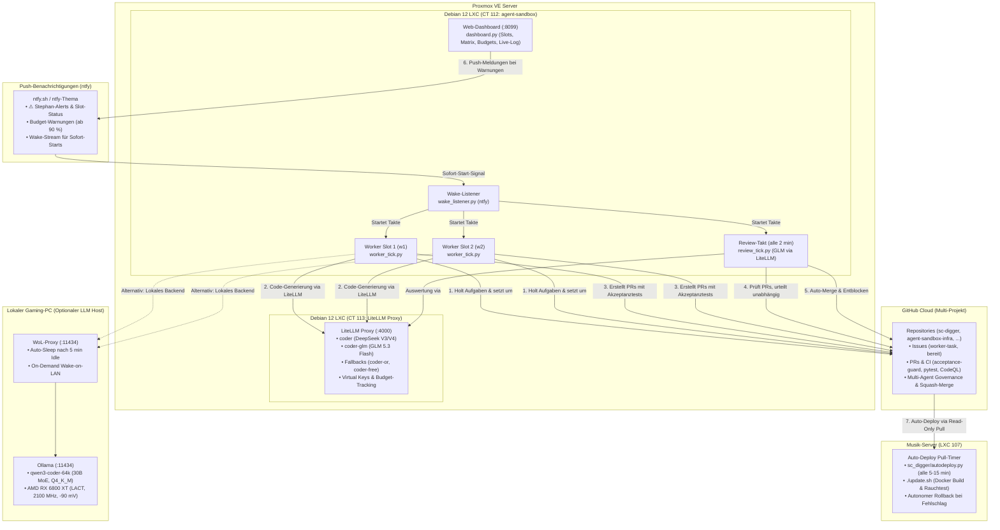

# 🤖 Agent-Sandbox-Infra

> **Autonome Multi-Agenten-Infrastruktur mit Proxmox LXC, isolierten parallelen Worker-Slots, automatischem Review- und Merge-Takt, LiteLLM-Budgetüberwachung, On-Demand WoL LLM-Host und autarkem Web-Dashboard mit ntfy-Push-Benachrichtigungen.**

---

## 🏛️ Architektur-Übersicht



---

## 🚀 Die 5 Ausbaustufen (Roadmap-Status)

Details und Verträge: [`ROADMAP.md`](ROADMAP.md).

| Stufe | Bezeichnung | Status | Kernmerkmale |
|:---:|---|:---:|---|
| **1** | **Autonomer Auto-Merge & Entblockierung** | ✅ **Live** | `review_tick.py` mergt PRs nach unabhängigem Freigabe-Urteil und grünem CI autonom per Squash-Merge (`gh pr merge --squash`); entblockt Folge-Issues (`Wartet auf: #X, #Y`). |
| **2** | **Strukturierte Slot-Telemetrie & HA-Dashboard** | ✅ **Live** ([#14](https://github.com/tripitest-art/agent-sandbox-infra/issues/14), PR [#48](https://github.com/tripitest-art/agent-sandbox-infra/pull/48)) | Atomare Statusdateien (`slot-1.json`, `slot-2.json`) in `/run/worker-slots/`, PID-Überwachung (Dead-PID Detection), reaktiver Webhook-Stream und Mushroom-Karten mit Live-Task, Modell, Laufzeit-Timer und GitHub-Direktlinks. |
| **3** | **Continuous Deployment (Pull-Timer auf CT 112)** | ✅ **Live** ([#15](https://github.com/tripitest-art/agent-sandbox-infra/issues/15)) | `autodeploy.py` prüft alle 15 Minuten `origin/main`, testet einen neuen Stand mit pytest, rollt ihn per `install.sh` aus und setzt bei Fehlern automatisch auf den letzten laufenden Stand zurück. Wartet, solange Worker oder Review arbeiten. Aus, bis `AUTODEPLOY=1` gesetzt ist; Betrieb: [`docs/autodeploy.md`](docs/autodeploy.md). |
| **4** | **Prime-Time & Kosten-intelligentes Scheduling** | ⏳ **Geplant** ([#16](https://github.com/tripitest-art/agent-sandbox-infra/issues/16)) | Dynamisches Umschalten von LiteLLM-Modellen anhand von DeepSeek Prime-Time Tarifen (Peak 1,20 $/1M vs. Off-Peak 0,60 $/1M), automatische Drosselung bei Budgetannäherung. |
| **5** | **Planer-Beschleunigung (AI Issue Pre-Flight)** | ⏳ **Geplant** ([#17](https://github.com/tripitest-art/agent-sandbox-infra/issues/17)) | Automatisierte Akzeptanztest-Validierung (Rot-Prüfung vor Issue-Freigabe), automatische Hotspot- und Abhängigkeitserkennung für den Planer. |

---

## 📁 Repository-Struktur

| Verzeichnis | Beschreibung |
|---|---|
| [`ROADMAP.md`](ROADMAP.md) | Roadmap und 5-Stufen-Optimierungsplan für den autonomen Multi-Agenten-Workflow. |
| [`CHANGELOG.md`](CHANGELOG.md) | Was seit dem letzten Deploy neu ist; eine Zeile pro Pull Request. |
| [`AGENTS.md`](AGENTS.md) | Verbindliche Einweisung und Governance-Regeln für alle KI-Agenten (Planer, Worker, Reviewer). |
| [`CLAUDE.md`](CLAUDE.md) | Einzeiler `@AGENTS.md`: Claude Code liest `CLAUDE.md`, nicht `AGENTS.md`; so gilt für alle Werkzeuge dieselbe Einweisung. |
| [`SECURITY.md`](SECURITY.md) | Meldeweg für Sicherheitslücken: GitHub „Private vulnerability reporting“; keine Zugangsdaten in öffentliche Issues. |
| [`LICENSE`](LICENSE) | MIT-Lizenz, Copyright (c) 2026 Stephan Voigt. |
| [`docs/`](docs/) | Vertiefende Dokumentation: [`planer-ablauf.md`](docs/planer-ablauf.md), [`mcp.md`](docs/mcp.md), [`mehrere-projekte.md`](docs/mehrere-projekte.md), [`backup.md`](docs/backup.md), [`autodeploy.md`](docs/autodeploy.md), [`litellm.md`](docs/litellm.md), [`egress-filter.md`](docs/egress-filter.md), [`betriebsbericht-2026-10-15.md`](docs/betriebsbericht-2026-10-15.md), GitHub Ruleset [`main-schutz.ruleset.json`](docs/main-schutz.ruleset.json). |
| [`skills/`](skills/) | Agenten-Skills für dieses Projekt (`agent-sandbox-review`). |
| [`scripts/`](scripts/) | Planer-Werkzeuge ohne Takt: `issuecheck.py` (Preflight für Issue-Texte) und `ws.py` (Worktrees je Werkzeug auf CT 106; Tests in `tests/test_ws.py`). |
| [`.github/`](.github/) | CI (`tests`, `acceptance-guard`), Issue- und PR-Vorlagen. Änderungen hier braucht Stephans Freigabe (`freigabe-geschützt`). |
| [`sandbox/`](sandbox/) | Steuerungslogik: Setup (`install.sh`, `install-lib.sh`), Worker-Takt (`worker_tick.py`, Rahmen für Branch, Akzeptanztest und PR-Text in `worker_frame.py`), Review-Takt (`review_tick.py`), Einstellungsdatei (`agent_settings.py`), Multi-Projektverwaltung (`projects.py`), Auto-Deploy (`autodeploy.py`, Timer `agent-sandbox-deploy` über `AUTODEPLOY=1`), Web-Dashboard (`dashboard.py`, Push-Meldungen in `dashboard_notify.py`, Review-Statistik in `dashboard_stats.py`, nur lesend, nur LAN, Dienst `agent-dashboard` über `DASHBOARD=1`), Wake-Listener (`wake_listener.py`, Dienst `agent-wake`), Changelog-Assembler (`assemble_changelog.py`), Housekeeping (`gc.py`, räumt über `agent-gc.timer` verwaiste Worktrees, gemergte Branches und alte Belegungen auf), eigenständige Schnittstellen-Module (`sandbox/core/gh_client.py` für die GitHub-CLI, `sandbox/core/litellm_client.py` für den LiteLLM-Proxy, `sandbox/core/claims.py` für die Auftrags-Belegung, `sandbox/core/git_ops.py` für Git-Operationen) und systemd-Units (`sandbox/systemd/`). |
| [`proxmox/`](proxmox/) | Host-Skripte zur Erstellung des unprivilegierten Debian 12 LXC-Containers auf Proxmox VE (`host-create.sh`). |
| [`hardware/`](hardware/) | AMD RDNA2 GPU-Tuning für den lokalen LLM-Host (LACT, 2100 MHz, −90 mV, 255 W) mit Benchmarks und Ollama-Overrides. |
| [`tests/`](tests/) | Testsuite für Worker-, Review- und Dashboard-Logik, Multi-Projekte und `acceptance_guard.py` (ohne Netzwerk mit Mocks). |

---

## ⚙️ Funktionsweise im Detail

### 1. Parallele Worker-Slots & Regel-8-Schutz
- **Prioritäts-Scoring (#240):** `issue_job()` sortiert die bereiten Kandidaten vor der Regel-8-Prüfung absteigend nach `calculate_issue_score()`; bei gleichem Score bleibt die bisherige Reihenfolge (`sort:created-asc`) erhalten. Der Score summiert drei Teile: das höchste Prioritäts-Label aus `PRIO_WEIGHTS` (`prio:kritisch` 1000, `prio:hoch` 300, `prio:normal` 100, `prio:niedrig` 0; ohne Label `DEFAULT_PRIO_SCORE` 100), einen Unblock-Hebel von `UNBLOCK_WEIGHT` (150) je offener `blockiert`-Aufgabe, die laut `Wartet auf: #N` auf das Issue wartet (höchstens `BLOCKED_ISSUES_LIMIT` 30 Aufgaben abgefragt; scheitert `gh`, gilt der Hebel als 0), und einen Anti-Starvation-Bonus von `AGING_WEIGHT_PER_DAY` (5) je Tag seit Erstellung, damit auch `prio:niedrig` nach einiger Zeit zum Zug kommt. `parse_dependencies()` ignoriert dabei Zeilen innerhalb von Code-Blöcken; ein fehlendes oder unlesbares `createdAt` kostet keinen Bonus.
- **Worktree-Isolation:** Mit `MAX_WORKERS=2` arbeitet jeder Slot in einem komplett isolierten Verzeichnis (z. B. `/root/sc-digger-worktrees/w1` und `/root/sc-digger-worktrees/w2`).
- **Sandbox-Check vor dem Claim und Crash-Recovery (#243):** Bevor der Takt ein Issue auf `in-arbeit` setzt, prüft `sandbox_health_check(WORKDIR, AGENT_USER)`, ob alle Elternverzeichnisse bis `/` für den Agenten-Nutzer durchquerbar (`x`) und der Arbeitsordner selbst für ihn schreibbar ist (Modusbits wie der Kernel: Eigentümer, Gruppe inklusive Zusatzgruppen, sonst Sonstige; `root` umgeht sie). Schlägt der Check fehl, entsteht kein Claim und damit keine Regel-8-Sperre – der Lauf endet mit einer `⚠ Stephan:`-Zeile, die den blockierenden Pfad nennt. Gestartet wird der Agentenprozess seit #243 mit `user` **und** `group`, sonst behielte das Kind die GID des Takts (auf dem Server 0). Bricht ein Lauf trotzdem an einem Infrastrukturfehler ab (`EACCES`, `permission denied`, `ENOSPC`, `MODULE_NOT_FOUND`, `Cannot find module`; gesucht in jeder Ausgabezeile, gespeichert wird die erste Trefferzeile mit höchstens 120 Zeichen), nimmt `main()` den Versuch zurück und `release_failed_claim()` setzt das Issue sofort von `in-arbeit` auf `bereit`, statt 45 Minuten als Phantom-Claim zu blockieren. Rote Tests des Modells bleiben reguläre Fehlschläge und verbrauchen weiter einen Versuch.
- **Dateikollisionsschutz (Regel 8):** Der Taktgeber liest vor Auftragsannahme alle aktiven Aufgaben. Hat ein Issue Überschneidungen in `### Betroffene Dateien` mit einer bereits laufenden Aufgabe oder berührt die Sperrdatei des Projekts (`hotspot`, z. B. `sc_digger/main.py` mit `hotspot_label = berührt-main.py` für `sc-digger` oder `sandbox/worker_tick.py` mit `hotspot_label = berührt-worker_tick.py` für dieses Repo in [`sandbox/projects.example.json`](sandbox/projects.example.json)), wird es übersprungen, bis der andere Slot fertig ist (Logzeile bei Treffer: `berührt … während bereits ein Auftrag … in Arbeit ist`). Doku-Pflichtzeilen zählen dabei nicht als Kollision: `CHANGELOG.md`, `README.md` und Akzeptanztest-Pfade unter `tests/acceptance/`, die mit `test_issue_` beginnen (im Issue-Text steht dort oft der Platzhalter `<N>`), entfernt `collision_files()` vor dem Vergleich (#189); Code-Dateien und der Hotspot blockieren weiterhin. Seit #58 fällt Regel 8 nicht mehr offen aus („unbekannt = blockieren“): `parse_affected_files()` liefert `None` statt `set()`, wenn die Sektion `Betroffene Dateien` fehlt oder leer ist (Dateien ohne Endung wie `Dockerfile` und Verzeichnisse wie `sandbox/` werden erkannt); scheitert die Abfrage der aktiven Aufträge (`active_in_progress_issues()` gibt `None`), startet kein Auftrag; ein Kandidat ohne belegte Dateiliste wird mit Logzeile übersprungen. Dauert eine Kollision mit demselben aktiven Auftrag ununterbrochen länger als `KOLLISION_MELDUNG_MINUTEN` (60 min), meldet der Takt dies genau einmal als `alarm()` mit der Issue-Nummer des Blockierers (#206).
- **Modell-Fallback:** Vor jedem Lauf prüft der Worker mit einem Mini-Probe-Call das primäre Modell (`coder`, DeepSeek). Antwortet es nicht innerhalb des Timeouts, weicht er automatisch auf konfiguierte Alternativen aus (`coder-or` via OpenRouter, `coder-free` via Codestral).
- **LiteLLM-Ausfall (#180):** Antwortet der Proxy länger als 20 Minuten nicht, schreibt der erste Slot genau eine `⚠ Stephan:`-Zeile („LiteLLM seit N Minuten nicht erreichbar; Worker und Review stehen“), und die Rückkehr steht ohne „⚠“ im Log; ein kurzer Aussetzer bleibt still.
- **Aufräumen der Belegung (#170):** Zu Beginn jedes Laufs löscht `cleanup_claims()` in `CLAIM_DIR` `.done`-Marken und `.claim`-Dateien nicht mehr lebender Prozesse, sobald sie älter als `CLAIM_MAX_AGE_DAYS` (30 Tage) sind; junge Dateien, fremde Endungen, Unterverzeichnisse und Belegungen lebender Prozesse bleiben, und gelöschte Dateien erscheinen als `<n> alte Belegungsdateien aufgeräumt.` im Log.
- **Deterministischer Rahmen für Branch, Akzeptanztest und PR-Text (#171, #234):** Vor dem Start des Agenten ruft `main()` nach `ensure_pre_push_hook()` `prepare_issue_frame()` auf. Die Funktion liest den Issue-Text und lässt `worker_frame.setup_issue_branch()` in `WORKDIR` den Branch `feature/issue-<N>` anlegen (`git checkout -B`) und den Akzeptanztest-Block zeichengenau als ersten Commit (`tests/acceptance/test_issue_<N>.py`) sichern. Fehlt der Block oder scheitert ein `git`-Befehl, unterbricht der Takt mit einer `⚠ Stephan:`-Zeile („Akzeptanztest-Block“), ohne den Agenten zu starten; ohne `WORKDIR` (etwa in Tests mit gefaktem Arbeitsbaum) tut die Funktion nichts. Nach dem Lauf vervollständigt `autofix_pr_text()` einen unvollständigen PR-Text (`pr_text_problems`: `Closes #N`, `Worker:`-Zeile, Vorlagen-Überschriften) direkt per `gh pr edit` aus `worker_frame.build_pr_body()` – ohne Modelllauf; scheitert `gh`, greift wie bisher `warn_text()`, und der nächste Takt trägt den Text nach.
- **Aktueller `main` im Issue-Branch (#208):** Direkt nach `prepare_issue_frame()` führt `sync_issue_branch_with_main()` in `WORKDIR` `git fetch origin` aus und merged `origin/main` nur dann in den Branch, wenn er noch kein Vorfahr des Branch-Kopfs ist. Ein fortgesetzter Branch (etwa aus einem früheren Lauf) bekommt so den aktuellen Stand, bevor der Agent startet; sonst lehnte der Pre-Push-Hook jeden Push wegen längst behobener Tests ab. Bei einem Konflikt bricht die Funktion den Merge ab, lässt den Branch unverändert und schreibt `Warnung: issue<N>: origin/main lässt sich nicht in den Branch mergen (Konflikt).`; die Auflösung bleibt dem Agenten im Lauf.
- **PR-Stand vor der Nacharbeit (#215):** Zwischen der Auswahl einer Nacharbeit und dem Agentenstart liegt die Modellprobe (`choose_model`, bis `PROBE_TIMEOUT`); in dieser Zeit kann der PR gemergt oder geschlossen werden oder einen fremden Commit bekommen. `verify_rework_pr()` liest deshalb unmittelbar vor dem Lauf `gh pr view <N> --json state,headRefOid` und lässt den Lauf ohne Versuchszähler aus, wenn der PR nicht mehr `OPEN` ist oder `headRefOid` vom Stand bei der Auswahl abweicht: `<skey>: Nacharbeit übersprungen (<Grund>)`. Eine gescheiterte oder unvollständige Auskunft hält die Nacharbeit nicht an (`Warnung: PR #<N> nicht prüfbar (<Klasse>), Nacharbeit läuft.`).
- **Push und Pull Request durch den Takt (#172):** Nach dem Agentenlauf übernimmt `open_pr()`: Liegen laut `git rev-list --count` Änderungen über den Akzeptanztest-Commit hinaus vor und existiert noch kein offener PR, pusht der Takt auf `origin` (der `pre-push`-Hook prüft die Tests; bei Ablehnung erfolgt ein Alarm und kein PR), baut mit `build_pr_body()` den PR-Text aus der Vorlage und den Commit-Nachrichten und legt den Pull Request über `gh pr create` an.
- **Tagesbudget des Worker-Keys (`key_info`/`budget_problem`):** Vor der Modellprobe liest der Takt `GET {LITELLM}/key/info` mit dem eigenen Schlüssel. Ist das Budget aufgebraucht (`spend >= max_budget`), beantwortet LiteLLM auch die Ausweichmodelle mit 429 – der Takt wartet dann, ohne einen Versuch zu verbrauchen, und läuft nach dem Reset von selbst weiter; die Zeile nennt nur den Reset-Zeitpunkt, keine Budgetwerte. Eine unklare Lage (keine Antwort, kein Limit, keine Zahlen) hält den Takt nicht an.
- **Push-Sperre (`pre-push`-Hook; #68, #212, #216):** Vor jedem Agentenlauf schreibt `worker_tick.py` einen `pre-push`-Hook in den Klon des Slots (`ensure_pre_push_hook`, Ordner von `git rev-parse --git-path hooks`). Er setzt zuerst `GIT_DIR` und die übrigen `GIT_*`-Variablen zurück, die git beim Push aus einem Worktree in den Hook gibt (sonst legen die Tests ihre Wegwerf-Repos im echten Klon an), führt dann `TEST_CMD` über `env -i` in einer sauberen, CI-gleichen Umgebung mit isolierten Pfaden für `AGENT_PROJECTS` und `AGENT_SETTINGS` aus (#216) und lehnt den Push bei roten Tests ab. Nur die Eskalation mit Draft-PR darf `git push --no-verify` nutzen; der Auftrag sagt das ausdrücklich. Scheitert das Setzen des Hooks, startet der Lauf nicht (Meldung `⚠ Stephan:`).
- **`gh`-Fehler mit festem Grund (#161):** `worker_tick.py` und `review_tick.py` erkennen am `gh`-Fehler, ob das Rate-Limit erreicht ist, der Token ungültig oder abgelaufen ist oder GitHub nicht erreichbar ist (`gh_fehler_grund`); die `⚠ Stephan:`-Zeile nennt diesen Klartext und nie den Text aus dem `gh`-Fehler (Regel 5). Der Worker meldet denselben Grund je Slot nur einmal und erst nach einem Lauf ohne `gh`-Fehler wieder; ein Rate-Limit beendet den Review-Lauf, statt für die übrigen Projekte weiter Kontingent zu verbrauchen.
- **Roter `main` (#168):** Bevor der Takt ein neues Issue zum Auftrag macht, fragt er den jüngsten abgeschlossenen Lauf des Workflows `tests` auf `main` ab (`gh run list --workflow tests --branch main --status completed --limit 1`). Ist er rot, entstehen keine neuen Issue-Aufträge, und je Commit erscheint eine `⚠ Stephan:`-Zeile. Nacharbeit an offenen PRs und PR-Text-Aufträge laufen weiter, weil eine Nacharbeit gerade die Reparatur sein kann; sie fragen `main` nie ab, und ohne Issue-Kandidat entfällt die Abfrage ganz. Ein gescheiterter `gh`-Aufruf blockiert nicht, sondern hinterlässt nur `Warnung: Zustand von main nicht abfragbar (<Klasse>).`, damit ein defektes `gh run list` die Pipeline nicht stilllegt.
- **Lokaler Pre-Flight-Check (#221):** CI-grün heißt nicht server-lokal-grün. Bevor `find_job()` einen Issue-Auftrag freigibt (und nur dann, nach dem billigen CI-Check aus #168), führt `check_main_health()` `git fetch` und `TEST_CMD` in einem temporären Worktree von `origin/main` aus (`MAIN_HEALTH_TIMEOUT`, Vorgabe 600 s) in derselben sauberen Umgebung wie der Pre-Push-Hook (`main_health_env()`: nur `PATH`, `HOME` und leere Projekt- und Einstellungspfade; Servereinstellungen wie `LITELLM_MODEL=coder-go` erreichen die Tests nicht, sonst meldete der Check ein CI-grünes `main` als rot). Ist der Lauf rot, entstehen keine neuen Issue-Aufträge, und je Commit erscheint eine `⚠ Stephan:`-Zeile („Lokale Tests auf origin/main (<sha>) rot; keine neuen Issue-Aufträge“); Nacharbeit und PR-Text laufen weiter. Eine grüne Marke `main_health_<sha>.ok` unter `CLAIM_DIR` erspart den Testlauf auf demselben Commit, ein rotes `main` wird dagegen bei jedem Takt neu getestet, damit eine Reparatur sofort wirkt. Unbekannt blockiert nicht: ein gescheiterter fetch, Worktree oder Testlauf (Timeout) hinterlässt nur eine `Warnung:`-Zeile. Der temporäre Worktree wird immer entfernt und `git worktree prune` nachgeschoben; während eines pytest-Laufs (`PYTEST_CURRENT_TEST`) entfällt der Check ganz, damit Tests keine echten Git- oder Testläufe starten.
- **Verwaiste Aufträge & automatische Freigabe (#183, #206, #207):** Steht ein Issue seit mindestens 40 Minuten auf `in-arbeit`, ohne offenen PR auf `feature/issue-<N>` und ohne lebende Belegung, meldet das der erste Slot einmal je Issue als `⚠ Stephan:`-Zeile („Issue #N steht seit M Minuten auf in-arbeit, ohne Lauf und ohne PR; Label prüfen“; #183). Ein verwaister Claim (kein offener PR mit Branch `feature/issue-<N>`, kein aktiver Slot; ein Branch auf GitHub zählt nicht, da der Worker erst nach dem Lauf pusht) wird ab `ORPHAN_MINUTEN` (45 min) automatisch freigegeben: Der Takt setzt das Label auf `bereit` zurück, alarmiert Stephan per `alarm()`, protokolliert das Ereignis `orphan_claim_released` im Audit-Log und nimmt das Issue aus der Kollisionsmenge, sodass blockierte Kandidaten sofort zum Zug kommen (#206). Die automatische Freigabe nach 45 Minuten (#206) löst die reine Meldung nach 40 Minuten (#183) ab: ein unberührtes Issue wird nach 40 min gemeldet und nach weiteren 5 min automatisch auf `bereit` zurückgesetzt. Ist eine GitHub-Abfrage nicht möglich, bleibt die Lage unbekannt und nichts wird freigegeben. Die Freigabe läuft auch dann, wenn es keinen `bereit`-Kandidaten gibt (etwa weil alle übrigen Issues `blockiert` sind); sonst bliebe genau der Fall liegen, für den sie gedacht ist (#207).
- **Erledigte Parkmarken und Leerlauf-Telemetrie (#187, #211):** Wird ein geparkter Issue-Auftrag nach dem letzten gezählten Versuch wieder mit `bereit` beschriftet (Ereignis `labeled`), entfernt der Takt vor der Auswahl die Parkmarke und den Versuchszähler automatisch (`<skey>: wieder auf bereit gesetzt, Parkmarke entfernt.`; #211). Ist ein geparkter Auftrag erledigt (PR gemergt oder geschlossen, Issue geschlossen), entfernt der Takt vor der Auswahl die Marke `_park:<skey>` und den Versuchszähler und protokolliert `<skey>: erledigt, Parkmarke entfernt.` — sonst meldete der Slot endlos „`<skey>`: wartet auf Stephan“ (Fall `pr277` nach dem Merge am 14.10.). Im Leerlauf nennt die Slot-Telemetrie zusätzlich die von Regel 8 übersprungenen Kandidaten („Übersprungen (N): #329: Datei-Kollision mit aktivem Auftrag auf …; #349: …“, höchstens drei, dann `+K weitere`); ein `gh`-Fehler, eine unlesbare Antwort oder ein unbekannter Zustandsschlüssel lässt die Marke stehen (im Zweifel geparkt).
- **Stillstandsalarm (#218):** Findet der Takt keine Arbeit, obwohl etwas wartet (mindestens ein von Regel 8 übersprungenes Issue oder ein geparkter Auftrag), merkt er den Beginn in `_stillstand` im Zustand. Dauert das ununterbrochen `STILLSTAND_MINUTEN` (60), schreibt der erste Slot genau einmal eine `⚠ Stephan:`-Zeile „Stillstand seit M Minuten: <bis zu drei Gründe, mit „; “ getrennt, ansonsten „; +K weitere“>“; danach bleibt es bis zum Ende des Stillstands still. Wird wieder Arbeit gefunden oder wartet nichts mehr, endet der Stillstand; ein neuer meldet erneut. Die Logzeilen der übersprungenen Kandidaten bleiben unverändert.
- **Audit-Log (`AUDIT_LOG`, Vorgabe `/root/audit.jsonl`; #85):** `worker_tick.py` hängt je Ereignis eine JSON-Zeile an — Zeitstempel in UTC, `event`, Slot, Modell und die übergebenen Felder — damit sich Takte maschinell auswerten lassen, ohne den Fließtext in `/root/worker.log` zu parsen. `model` ist der Ollama-Name, `active_model` das tatsächlich genutzte Modell (mit `BACKEND=litellm` der Alias des Laufs, nach dem Ausweichen also z. B. `coder-free`; #147). Den Anfang macht die Übernahme eines Issues (`issue_claimed`, Funktion `audit()`); Felder wie `token`, `api_key` oder `authorization` stehen nur als `***` drin (Regel 5). Schreibfehler brechen den Lauf nicht ab, sondern kommen als `Audit-Log nicht schreibbar: <Fehlerklasse>` ins Log. Seit #178 stehen auch die Kosten darin: `run_started`/`run_finished` je Agentenlauf, `run_cost` einen Takt später aus der Differenz des `spend` in `GET /key/info` (`parallel`, wenn ein anderer Slot im selben Zeitraum lief — dann ist der Wert eine Obergrenze) und `review_posted` je gepostetem Review mit `kosten` aus `usage["cost"]` der Modellaufrufe. Seit #222 protokollieren beide Takte zusätzlich die Lifecycle-Ereignisse `agent_run_finished` (Issue, Modell, Exit-Code, Token-Usage und `cost`), `pr_opened` (nur für einen in diesem Lauf neu angelegten PR) und `stephan_alarm` (aus `alarm()`, `to_stephan()`, bei nicht gesetztem Review-Status und bei unbrauchbarer Reviewer-Konfiguration); `dashboard_stats.py` liest primär daraus (`build_stats()` → `preload_audit()`) und fällt nur für Zeiträume vor der Einführung des Audit-Logs auf die bisherige Regex-Auswertung von `/root/worker.log` zurück.
- **Einstellungsdatei (`/etc/agent-settings.json`, `agent_settings.py`; #164):** `worker_tick.py` und `review_tick.py` lesen unkritische Werte beim Start jedes Laufs aus einer kleinen JSON-Datei (Pfad über `AGENT_SETTINGS`, Vorgabe `/etc/agent-settings.json`): `REVIEW_MAX_TOKENS`, `REVIEW_LLM_TIMEOUT`, `MAX_ROUNDS`, `MAX_TRIES`, `MISSING_CHECK_GRACE_S` und `REVIEW_MODEL_BIG`. Die Datei gewinnt vor der Umgebungsvariable, die Umgebung vor der Vorgabe im Code; ungültige oder unbekannte Einträge werden ignoriert, die Takte starten immer. Weil jeder Lauf ein eigener Prozess ist, gilt eine Änderung ab dem nächsten Takt, ohne Neustart. Die feste Liste schützt die Aufsicht: `REVIEW_MODEL`, `REVIEWER_NAME`, `auto_merge`, `manual_paths`, Timer-Intervalle und alles mit Schlüsseln, Tokens oder Pfaden sind nicht enthalten und nicht ergänzbar. `agent_settings.aktuelle_werte()` nennt Wert und Quelle je Eintrag (Grundlage für die Oberfläche in Teil 2), `agent_settings.save()` prüft und schreibt die Datei atomar.

### 2. Autonomer Review-Takt & Auto-Merge
- `review_tick.py` läuft alle 2 Minuten als unabhängiger systemd-Timer (`REVIEW_TAKT`); ein Modellaufruf entsteht nur für einen neuen Commit.
- **Sofort-Start statt Warten:** `.github/workflows/wake.yml` schickt bei Label `bereit`, PR-Ereignissen und fertigen Checks das Wort „wake“ an einen ntfy-Strom (GitHub-Secret `WAKE_PUBLISH_URL`, Inhalt und Thema nie im Repo). Der Dienst `agent-wake` auf dem Server hört dort ausgehend mit und startet die Takt-Units sofort (Teil 1: #128). Die Timer bleiben als Sicherheitsnetz.
- **Unabhängiges Modell:** Reviews werden mit `coder-glm` (GLM 5.3 Flash) durchgeführt – strikt getrennt von der Worker-Modellfamilie (Anzeige beim Deploy: `Review-Takt: an (…, coder-glm, …)`). Die zuvor für große Diffs genannte Option `longctx-lite` hatte keine belegte Modellfamilie, wodurch der Review-Takt sich selbst blockierte (behoben mit PR #57); aktuell läuft alles einheitlich mit `coder-glm`.
- **Ausweichen bei unbrauchbarer Antwort:** Liefert das aufgerufene Modell nichts Verwertbares (Antwort ans Token-Limit gestoßen, kein Urteil, ungültige Muss/Kann-Zahlen), fragt der Takt im selben Lauf das jeweils andere der beiden eingestellten Modelle (`REVIEW_MODEL`, `REVIEW_MODEL_BIG`), sofern dessen Familie unabhängig vom Worker ist (`fallback_model`); erst wenn beide scheitern, zählt das als ein Fehlversuch. Eine Urteilszeile ohne Sterne oder mit Satzzeichen wird dabei ebenfalls gelesen und in die feste Form gebracht (`normalize_verdict_line`), und Reviewer-Zeile wie Entwurf nennen das Modell, das wirklich geantwortet hat (#139).
- **Anhaltender Modellausfall (#273):** Antwortet das Review-Modell in mehreren Takten hintereinander nicht (ein `URLError`, `OSError`, `ValueError` oder `KeyError` aus `call_llm`), zählt der Takt die Fehlschläge je Modellalias im Zustand (`ausfall`). Ab `REVIEW_OUTAGE_FAILS` (3) Fehlschlägen oder `REVIEW_OUTAGE_MINUTEN` (30) Minuten seit dem ersten Fehlschlag der Serie steht genau einmal eine `⚠ Stephan:`-Zeile im Log mit Alias, Minuten und Ausnahmeklasse — nie dem Ausnahmetext (Regel 5). Ein erfolgreicher Aufruf löscht den Zähler, ein späterer Ausfall meldet wieder. Die Zeile „antwortet nicht … nächster Takt“ bleibt unverändert; einen Modellwechsel gibt es nicht.
- **Automatischer Merge:** Bei Urteil `**Freigegeben**`, bestandenen Pflicht-Checks (`tests`, `acceptance-guard`, `CodeQL`) und `### Merge-Modus: automatisch` führt das Skript den Squash-Merge eigenständig durch.
- **PRs ohne Worker-Issue (Label `review-anfordern`):** Normalerweise nimmt der Takt nur PRs von `feature/issue-<N>`, deren Issue ein Worker-Label trägt. Ein von Hand oder mit Claude/Antigravity angelegter PR (z. B. `feature/dashboard-*`) wird trotzdem geprüft, sobald jemand mit Schreibrecht am Repository das Label `review-anfordern` setzt (`REVIEW_REQUEST_LABEL`); das Review läuft unverändert (Familienregel, Pflicht-Checks, Runden, Status `review`). Gibt es kein zugehöriges Worker-Issue, prüft der Takt gegen PR-Text und Regeln; maßgeblich für den Merge ist dann der PR-Text: Steht dort `Merge-Modus: automatisch` (oder der Abschnitt `### Merge-Modus` mit „automatisch“), mergt der Takt wie bei Worker-PRs, sonst liegt der PR nach dem Review bei Stephan. Die Projektgrenzen (`auto_merge: false`, `manual_paths`) gelten unverändert. Der Takt setzt oder entfernt das Label selbst nie, und Fork- sowie Draft-PRs bleiben ausgeschlossen.
- **Automatisches Entblocken:** Nach jedem Merge prüft das Skript alle blockierten Issues. Sind alle Bedingungen in `Wartet auf: #X, #Y` erfüllt, wird das Issue automatisch auf `bereit` umgestellt.

### 3. Multi-Projekt-Unterstützung (`/etc/agent-projects.json`)
Die Sandbox betreut mehrere Repositories parallel. In `/etc/agent-projects.json` (Vorlage: [`sandbox/projects.example.json`](sandbox/projects.example.json)) werden Projekte mit Kurzname, GitHub-Repo, lokalem Klon-Pfad und Hotspot-Regeln hinterlegt. Jeder Worker-Slot nimmt die nächste fällige Arbeit aus dem gemeinsamen Pool nach Priorität.

### 4. Wartung & Housekeeping
Der Timer `agent-gc.timer` startet alle 6 Stunden `sandbox/gc.py` (installiert als `/root/gc.py`). Ein Durchlauf räumt drei Dinge auf: administrative Reste verwaister Git-Worktrees (`prune_worktrees` ruft `git worktree prune` im Klon jedes Projekts aus der Projektliste auf), lokale Branches, die bereits in `main` eingegangen sind (`cleanup_merged_branches` filtert `main`, `master` und den aktiven Branch heraus und löscht nur mit `git branch -d`; ungemergte Branches bleiben stehen, `-D` gibt es nicht), und Belegungsdateien in `/var/lib/worker-claims`, deren `.done`- oder `.claim`-Marke älter als 7 Tage ist (`prune_claims`; junge Dateien und fremde Endungen bleiben). Ein fehlender Klon oder ein Git-Fehler eines Repositories bricht den Durchlauf nicht ab; die Statistikzeile `gc: N Belegungen, M Branches, K Repositories aufgeräumt.` steht in `/root/worker.log`. Manuell prüfen: `python3 /root/gc.py`.

---

## 🚀 Schnelleinrichtung in 3 Schritten

### 1. Sandbox auf Proxmox anlegen
Auf dem Proxmox VE Host:
```bash
CTID=$(pvesh get /cluster/nextid) bash proxmox/host-create.sh
```

### 2. GitHub-Zugang hinterlegen
Im Container CT 112:
- Per `gh auth login --with-token` einen feingranularen GitHub Personal Access Token (PAT) hinterlegen (mit Rechten für Issues, Pull Requests und Workflows im Arbeits-Repository).
- `install.sh` erzeugt bei Bedarf einen lesenden Deploy-Key (`/root/.ssh/agent_infra_deploy`).

### 3. Installation & Konfiguration ausführen
```bash
cd /root/agent-sandbox-infra
bash sandbox/install.sh
```
Das Skript fragt fehlende Geheimnisse verdeckt ab (LiteLLM-Key → `/etc/qwen-worker.env`, Reviewer-Key → `/etc/qwen-reviewer.env`, ntfy-URL für den Wake-Listener → `/etc/agent-wake.env`, alle Rechte `0600`) und richtet die systemd-Dienste ein:
- Einstellungen wie `MAX_WORKERS=2`, `REVIEW_POST=1` und `REVIEW_AUTO_MERGE=1` werden dauerhaft in `/etc/agent-sandbox.conf` gespeichert.
- `AGENT` (`qwen-code` oder `opencode`) und `CONTEXT_MODE` (`0` oder `1`) werden ebenfalls in `/etc/agent-sandbox.conf` gemerkt; ohne den Merker fiele ein späterer Lauf (auch der Auto-Deploy) auf `qwen-code` ohne Plugin zurück. Ungültige Werte brechen vor dem Merken ab. Bei `AGENT=opencode` schreibt `install.sh` `/root/.config/opencode/opencode.json` gehärtet: `webfetch`, `question`, `plan_enter`, `plan_exit` und `external_directory` sind gesperrt (keine Rückfragen im Timer-Betrieb, kein Zugriff außerhalb des Arbeitsordners), das Ollama-Modell bekommt die Sampling-Parameter von Qwen3-Coder (`temperature` 0.7, `topP` 0.8). Mit `CONTEXT_MODE=1` trägt die Datei `"plugin": ["context-mode"]` ein und `install.sh` installiert das npm-Paket `context-mode` global.
- Ressourcenlimits je Worker-Slot: `SLOT_MEMORY_MAX` (z. B. `1200M`), `SLOT_TASKS_MAX` (z. B. `512`) und `SLOT_CPU_PERCENT` (z. B. `150`) landen als `MemoryMax`, `TasksMax` und `CPUQuota` in `qwen-worker@.service` und werden ebenfalls gemerkt. Leer oder `none` heißt kein Limit (so ist es ohne Angabe; ein bestehender Betrieb ändert sich nicht). Ungültige Werte brechen das Skript vor dem Merken ab. Beispiel: `SLOT_MEMORY_MAX=1500M SLOT_TASKS_MAX=256 SLOT_CPU_PERCENT=200 bash sandbox/install.sh`. Gemessen am 16.10.2026 (CT 112, 2 Slots, gut eine Woche Betrieb, aus den cgroup-Dateien von `system-qwen-worker.slice`): Speicherspitze beider Slots zusammen 2704 MiB, davon fast alles Seitencache (aktuell fast kein anonymer Speicher), höchstens 70 Prozesse gleichzeitig, kein Swap. Daraus der Vorschlag für den 4-GB-Container bei 2 Slots: `1500M`, `256`, `200` (Summe 3000M, damit Review, Dashboard und System noch Platz haben); bei mehr Slots die Speichergrenze senken. Ein vom Limit beendeter Lauf steht im `journalctl`, nicht als „⚠ Stephan:“-Zeile in `worker.log`.
- Logrotation: `install.sh` installiert `logrotate` und legt `/etc/logrotate.d/agent-sandbox` an; `/root/worker.log` und `/root/audit.jsonl` werden ab 50 MB rotiert, vier Rotationen bleiben komprimiert aufbewahrt (größere Grenze: `LOG_ROTATE_SIZE=200M bash sandbox/install.sh`).
- Der Timer `agent-sandbox-deploy.timer` startet alle 15 Minuten `sandbox/autodeploy.py` (Auto-Deploy von `origin/main`, mit Pre-Flight-Test in einer systemd-Sandbox und Rollback unter Nennung roter Tests). Er ist aus, bis `AUTODEPLOY=1 bash sandbox/install.sh` läuft; die Einstellung merkt sich `/etc/agent-sandbox.conf`. Ablauf und Betrieb: [`docs/autodeploy.md`](docs/autodeploy.md).
- Der Dienst `agent-dashboard.service` startet das Web-Dashboard `sandbox/dashboard.py` (nur lesend, ohne Login). Er ist aus, bis `DASHBOARD=1 bash sandbox/install.sh` läuft; `DASHBOARD` und `DASHBOARD_PORT` (Standard 8099) merkt sich `/etc/agent-sandbox.conf`. Die Seite zeigt Slots, Projekt-Matrix, „braucht Stephan“, LiteLLM-Budgets, das Live-Log und in der Kopfzeile die aktuell deployte Version (Kurz-Hash und Zeitpunkt aus `.deploy-state.json`, Feld `version`; leer ohne Auto-Deploy oder vor dessen erstem Lauf); schlägt ein Auto-Deploy fehl, erscheint der zurückgerollte Stand als Banner. Budgets liest er aus `/etc/qwen-worker.env` und `/etc/qwen-reviewer.env`. Die Limits (`max_budget`) lassen sich dort ändern, wenn `/etc/agent-dashboard.env` (600) `LITELLM_MASTER_KEY` und `DASHBOARD_WRITE_TOKEN` (mind. 16 Zeichen) enthält; `install.sh` fragt den Master-Key nicht mehr ab, sondern nur den Schreib-Token — wer den Budget-Weg braucht, trägt den Key von Hand in `/etc/agent-dashboard.env` ein; leer lassen heißt „nur lesen“. Geändert wird nur `max_budget`, jede Änderung steht im Journal des Dienstes. Der Abschnitt „Einstellungen“ zeigt die unkritischen Werte aus `/etc/agent-settings.json` mit ihrer Quelle (Datei, Umgebung, Vorgabe); mit `DASHBOARD_WRITE_TOKEN` lässt sich ein Wert direkt ändern (`POST /api/settings`, ohne Master-Key), die Änderung gilt ab dem nächsten Takt. Der Knopf „Takt starten“ (oben auf der Seite, nur wenn `WAKE_PUBLISH_URL` und `DASHBOARD_WRITE_TOKEN` in `/etc/agent-dashboard.env` stehen) schickt das Wort „wake“ per POST an dieses ntfy-Thema (volle URL, also das Thema aus `WAKE_URL` in `/etc/agent-wake.env` ohne das angehängte `/json`); der Wake-Listener `agent-wake` startet daraufhin sofort die Takt-Units, ohne dass das Dashboard `systemctl` oder einen Unterprozess aufruft. **Empfohlen ist „nur lesen“, ohne Master-Key auf CT 112:** Die Worker laufen dort als root und können jede `/etc/*.env` lesen; ein durch fremden Text gelenkter Agent könnte mit dem Master-Key sein eigenes Limit anheben oder Keys anlegen und damit den Tagesdeckel aushebeln (Regel 9). Budgets ändert man dann im LiteLLM-Dashboard auf dem Proxy (CT 113, Pfad `/ui`). Steht der Master-Key schon in der Datei: `sed -i '/^LITELLM_MASTER_KEY=/d' /etc/agent-dashboard.env && systemctl restart agent-dashboard`. Der Abschnitt „Reviews und Merges“ zählt aus `worker.log` (24 Stunden, 7 Tage, je Projekt): gepostete Reviews „Freigegeben“ und „Änderungen nötig“, Freigabequote, Merges und Merge-Fehler, Übergaben an Stephan und Worker-Fehler. Die Zahlen sind nur so genau wie das Log; dazu je Reviewer-Alias (7 Tage), sobald `review_tick.py` ihn in die Logzeile schreibt (ältere Zeilen zählen unter „unbekannt“, rote Checks ohne Modellaufruf unter „ohne-Modell“). Beim Start liest der Dienst bis zu 20 MB vom Ende des Logs. Push-Meldungen kommen über ntfy, wenn `NTFY_URL` (volle URL samt geheimem Topic, optional `NTFY_TOKEN`) in `/etc/agent-dashboard.env` steht: bei neuen `⚠ Stephan`-Zeilen, totem Slot-Prozess, Budget ab 90 % (einmal je Key und Tag) und über 10 Minuten veralteten Daten. Test: `python /root/dashboard.py --notify-test` (liest `/etc/agent-dashboard.env` selbst). Die URL hat die Form `https://ntfy.sh/<Thema>`, einmal und ohne `/` am Ende, das Thema nur aus Buchstaben, Ziffern, `-` und `_` (höchstens 64 Zeichen). Ein doppelt eingetragener Pfad oder ein Schrägstrich am Ende führt zu `HTTP 307`; die Meldung nennt dabei den Host des Ziels, nie den Pfad. Bleibt das verdeckte Feld in `install.sh` leer (Einfügen kam nicht an), trägt man die Zeile direkt ein: `read -rs -p "ntfy-URL: " U; echo; printf 'NTFY_URL=%s\n' "$U" >> /etc/agent-dashboard.env; unset U`, danach `systemctl restart agent-dashboard`. Eine selbst gehostete ntfy-Instanz im LAN braucht eine `OUT ACCEPT`-Regel in der Proxmox-Firewall von CT 112; `ntfy.sh` im Internet geht ohne. Das Lesen hat keinen Login: nur im LAN erreichbar machen, nie per Portfreigabe, und vor Caddy `basic_auth` setzen.
- Der Dienst `agent-wake.service` startet den Wake-Listener `sandbox/wake_listener.py`. Er hält eine ausgehende Verbindung zu einem ntfy-Thema (`WAKE_URL` in `/etc/agent-wake.env`), um bei GitHub-Ereignissen (z. B. neues Issue `bereit`, PR-Aktualisierung, beendete Checks) die Takt-Units sofort per `systemctl start --no-block` anzustoßen. Die periodischen Timer (`qwen-worker.timer`, `qwen-review.timer`) bleiben als Sicherheitsnetz für verpasste Signale oder netzwerklose Phasen unverändert bestehen. Fehlt `WAKE_URL`, bleibt der Dienst deaktiviert (`disable --now`) und die Sandbox arbeitet wie bisher rein timerbasiert. `WAKE_URL` ist die JSON-Strom-Adresse des Themas und endet auf `/json`: `https://ntfy.sh/<Wake-Thema>/json`, einmal und ohne weiteren Pfad (der Listener ruft die URL unverändert ab und liest jede Zeile als ntfy-Ereignis; eine falsche URL zeigt sich als `Fehler im Wake-Stream: HTTPError` im Log). Das Wake-Thema ist ein anderes als das Dashboard-Thema (`NTFY_URL`), sonst löst jede Push-Meldung des Dashboards einen Takt-Start aus; man abonniert es nicht am Handy. Prüfung ohne das Thema auszugeben: `(set -a; . /etc/agent-wake.env; curl -s -o /dev/null -w '%{http_code}\n' --max-time 5 "$WAKE_URL")` liefert bei richtiger URL `200`, bei falschem Pfad `404`. Wer ins Thema schreibt, ist hier nicht festgelegt; ohne Absender hört der Listener nur zu.


---

## 🧑‍💻 Planer-Umgebung (CT 106)

CT 106 (`claude-desktop`) ist die Arbeitsumgebung für Planer und Stephan: ein Webtop (Docker im unprivilegierten LXC) mit Desktop und Terminal, in dem Claude Code, Antigravity (AGY) und OpenCode laufen. Sie ist von den Workern auf CT 112 getrennt. Hier wird geplant, geprüft (`scripts/issuecheck.py` mit Shell) und werden Issues angelegt; hier deployt nichts (Regel 4).

- **Grenzen:** Kein `install.sh`, kein `systemctl` und kein Zugriff auf CT 112 von hier aus. Zugangsdaten bleiben im Home des Containers oder im LiteLLM-Dashboard (CT 113, für OpenCode ein virtueller Schlüssel der Art „LLM API“ mit Modellliste und Budget), nie im Repository (Regel 5). Der GitHub-Zugang läuft über HTTPS mit einem feingranularen Token, der nur für die drei Repositories der Planer-Umgebung gilt und nur Contents, Pull requests und Issues (Lesen und Schreiben) kann, ohne Workflows und mit Ablaufdatum; ein kontoweiter SSH-Schlüssel liegt dort nicht mehr (die Umstellung steht in einer Anleitung im privaten Betriebs-Repository). Nie Stephans Voll-Login (Regel 9: ein durch fremden Text gelenkter Agent soll nicht mehr können als planen).
- **Ordner im Container:** Die Hauptklone liegen unter `/config/projects/<repo>` und werden nur mit `git pull` aktuell gehalten. Gearbeitet wird je Werkzeug und Aufgabe in einem eigenen Worktree unter `/config/work/<claude|agy|opencode>/<repo>-<kurz>` (Branch `feature/<kurz>` von `origin/main`; Regel 8). Entwürfe, die mehrere Werkzeuge lesen sollen, liegen unter `/config/work/entwuerfe`. Das Hilfsskript [`scripts/ws.py`](scripts/ws.py) legt den Worktree an (`python scripts/ws.py <werkzeug> <repo> <kurz>`); es holt zuerst `origin/main`, lehnt unbekannte Werkzeuge, Pfadanteile im Repo-Namen und Kurznamen außerhalb von `a-z`, `0-9`, `-` ab und überschreibt keinen bestehenden Ordner. Die Ordner lassen sich über `WS_PROJECTS` und `WS_WORK` verschieben. Auf CT 106 gibt es dazu den Aufrufer `ws` in `/config/.local/bin`, der nach dem Merge auf dieses Skript umgestellt wird.
- **Gleiche Einweisung:** `AGENTS.md` ist die einzige Quelle. `CLAUDE.md` verweist per `@AGENTS.md` darauf; OpenCode und AGY lesen `AGENTS.md` selbst (AGY am 21.10.2026 in einem Worktree geprüft: Regel 1 wörtlich zitiert; eine `GEMINI.md` ist nicht nötig).
- **Werkzeuge:** Node (im Home unter `/config/.local`, ohne Root), `opencode` und `context-mode` (npm global nach `/config/.local/bin`). In OpenCode steht `context-mode` als Plugin in `~/.config/opencode/opencode.json`; in Claude Code wird es mit `/plugin marketplace add mksglu/context-mode` und `/plugin install context-mode@context-mode` eingerichtet. In AGY (CLI `agy`) läuft es als lokales Plugin: `agy plugin install <Ordner>` mit dem Ordner `configs/antigravity-cli` des npm-Pakets. Mit `agy` 1.4.2 und `context-mode` 1.0.169 besteht `agy plugin validate --strict` erst, wenn `rules/context-mode.md` den Kopf `trigger: always_on` trägt; die so korrigierte Kopie liegt unter `/config/.local/share/context-mode-agy-plugin` und muss nach einem Update des Pakets neu erzeugt werden. Die Desktop-IDE von AGY bekommt nur den MCP-Eintrag in `~/.gemini/antigravity/mcp_config.json` (ohne Hooks, daher schwächere Wirkung). Jedes Werkzeug führt seinen eigenen Ordner `context-mode` (unter `~/.config/opencode` bzw. `~/.gemini`); danach sieht es so aus, als teilten sie keine Wissensdatenbank, geprüft ist das nicht.
- **Betrieb:** Zwei Desktop-Anwendungen gleichzeitig lasten die 3 Kerne aus (Messung am 21.10.2026: rund 91 % CPU mit beiden, rund 3 % ohne). Ein Neustart des Containers beendet alle laufenden Sitzungen. Vor Umbauten einen Snapshot anlegen (`pct snapshot 106 <name>`, später mit `pct delsnapshot` löschen); der Thin-Pool des Hosts ist überbucht, Snapshots kosten dort Platz.

---

## 🛡️ Multi-Agent Governance & Sicherheitsregeln

1. **GitHub `main` ist die einzige Wahrheit:** Agenten arbeiten strikt auf Feature-Branches; Merges erfolgen nur über Pull Requests mit bestandenen Pflicht-Checks (`tests`, `acceptance-guard`, `CodeQL`).
2. **Keine gleichen Familien beim Review:** Wenn ein Modell aus der DeepSeek/Qwen-Familie den Code umsetzt, prüft ein Modell aus der GLM-, Gemini- oder Claude-Familie den Pull Request (und umgekehrt).
3. **Vertragstreue durch den `acceptance-guard`:** Der Akzeptanztest aus dem GitHub-Issue wird zeichengenau als erster Commit gesichert. Der `acceptance-guard` verhindert serverseitig in der CI, dass ein Worker Tests abschwächt, überspringt oder verändert.
4. **Schreibschutz & Sandbox-Isolation:** Der Container ist unprivilegiert und besitzt keinerlei Schreibrechte auf Netzlaufwerke, Hypervisor oder den Musik-Server. Deployments erfolgen ausschließlich entkoppelt per Pull.
5. **Keine Secrets im Repository:** Webhook-IDs, API-Keys und Token liegen ausschließlich in `/etc/*.env` (chmod 600) auf dem Server und erscheinen niemals in Logs, Chat oder Code.

---

## ⚖️ Lizenz und Sicherheit

- **Lizenz:** MIT, Copyright (c) 2026 Stephan Voigt. Was andere mit dem Code tun dürfen, steht in [`LICENSE`](LICENSE); ohne diese Datei gälte „alle Rechte vorbehalten“.
- **Sicherheitslücken melden:** [`SECURITY.md`](SECURITY.md) nennt den vertraulichen Weg über GitHub „Private vulnerability reporting“ (`security/advisories/new`) und was in einem Bericht nicht stehen darf. Keine Zugangsdaten und keine Details in öffentliche Issues (Regel 5 in [`AGENTS.md`](AGENTS.md)).
