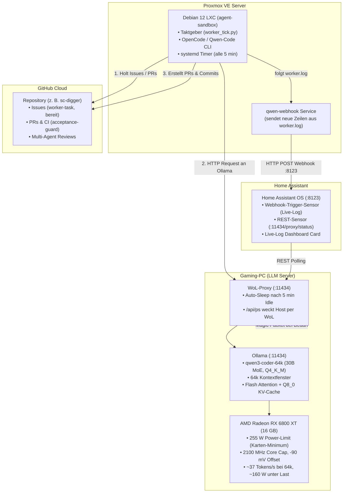

# 🤖 Agent-Sandbox-Infra

> **Autonome, isolierte Multi-Agenten-Entwicklungsumgebung mit Proxmox LXC, On-Demand Wake-on-LAN LLM-Server, hocheffizientem AMD RDNA2 GPU-Tuning und Home Assistant Live-Telemetrie.**

---

## 🏛️ Architektur-Übersicht



---

## 📁 Repository-Struktur

| Verzeichnis | Beschreibung |
|---|---|
| [`proxmox/`](proxmox/) | Shell-Skripte zur Erstellung des unprivilegierten Debian 12 LXC-Containers auf Proxmox VE. |
| [`sandbox/`](sandbox/) | Setup-Skripte (`install.sh`), der autonome Taktgeber (`worker_tick.py`), der Review-Takt (`review_tick.py`) und systemd-Units (`qwen-worker`, `qwen-review`, `qwen-webhook`). |
| [`hardware/`](hardware/) | GPU-Hardware-Tuning für AMD RDNA2 (LACT, 2100 MHz, −90 mV, 255 W) mit Messwerten und Ollama-Service Overrides. |
| [`homeassistant/`](homeassistant/) | YAML-Konfigurationen für REST- und Webhook-Sensoren sowie die Lovelace-Dashboard-Karte. |
| [`tests/`](tests/) | Unit-Tests für Worker- und Review-Takt (`test_worker_tick.py`, `test_review_tick.py`), laufen ohne Netzwerk mit Mocks. |

---

## 🚀 Schnelleinrichtung in 4 Schritten

### 1. Hardware & Ollama vorbereiten (LLM-Host)
* Kernel-Overdrive per `/etc/modprobe.d/amdgpu-overdrive.conf` (`ppfeaturemask=0xfff7ffff`) freischalten – kein Bootloader-Eingriff nötig.
* Mit LACT: Power-Limit 255 W (Minimum der Karte), Core 2100 MHz, Offset −90 mV, VRAM 1040 MHz (Details und Messwerte in [`hardware/amd-rdna2-tuning.md`](hardware/amd-rdna2-tuning.md)).
* Ollama mit `OLLAMA_FLASH_ATTENTION=1` **und** `OLLAMA_KV_CACHE_TYPE=q8_0` konfigurieren – q8_0 lädt ohne Flash Attention nicht.

### 2. Sandbox auf Proxmox anlegen
Auf dem Proxmox VE Host:
```bash
# Repo ist privat: host-create.sh vom eigenen Rechner kopieren, z. B. scp proxmox/host-create.sh pve:/root/
CTID=$(pvesh get /cluster/nextid) bash host-create.sh
```

### 3. SSH-Schlüssel & GitHub-Token hinterlegen
* SSH-Zugang für Steuerungs-Agenten in den Container eintragen (siehe [`proxmox/README.md`](proxmox/README.md)).
* Im Container per `gh auth login --with-token` einen feingranularen Token hinterlegen (nur für das Arbeitsrepo).
* Dieses Repo ist **privat**. `install.sh` legt einen Deploy-Key nur zum Lesen an
  (`/root/.ssh/agent_infra_deploy`) und gibt den öffentlichen Schlüssel aus. Ihn unter
  Settings → Deploy keys **ohne** Schreibrecht eintragen und `install.sh` erneut ausführen; dann
  läuft `git pull` über SSH. Erstes Klonen, solange noch kein Key existiert: Repo per `scp`
  in den Container kopieren oder mit einem kurzlebigen Token klonen.
* Den Taktgeber-Timer scharfschalten: `systemctl enable --now qwen-worker.timer`.

### 4. Modell-Backend & Home Assistant anbinden
* Standard ist `BACKEND=litellm`: Der Worker nutzt den Alias `coder` (DeepSeek) über den
  LiteLLM-Proxy (LXC 113, `http://192.168.0.211:4000`) mit eigenem Virtual Key und Tagesbudget.
  `BACKEND=ollama bash sandbox/install.sh` schaltet zurück auf Qwen3-Coder am Gaming-PC.
* Vor jedem Lauf prüft der Worker mit einer Mini-Anfrage (45 s), ob `coder` antwortet. Sonst
  nimmt er das erste Ausweichmodell aus `LITELLM_FALLBACKS` (Vorgabe `coder-or` = dasselbe DeepSeek über
  OpenRouter, danach `coder-free` = Codestral,
  kostenlos), und die Worker-Zeile im PR nennt dieses Modell. Antwortet keins, wartet er, ohne
  einen Versuch zu verbrauchen. Beispiel: `LITELLM_FALLBACKS=coder-free,coder-glm bash sandbox/install.sh`.
* Webhook-ID in HA `secrets.yaml` anlegen (siehe [`homeassistant/README.md`](homeassistant/README.md)); kein MQTT-Login mehr.
* `bash sandbox/install.sh` im Container fragt fehlende Geheimnisse verdeckt ab
  (LiteLLM-Key → `/etc/qwen-worker.env`, Webhook-URL → `/etc/qwen-webhook.env`, beide 600)
  und richtet `qwen-webhook.service` ein (ein alter `qwen-mqtt.service` wird entfernt). **Keine Geheimnisse ins Repo** – es ist öffentlich.
* YAML-Snippets aus [`homeassistant/`](homeassistant/) in die `configuration.yaml` und das Dashboard einfügen.

### 5. Review-Takt (optional, Vorgabe: nur Entwurf)
`review_tick.py` prüft die PRs des Workers, damit das Review nicht mehr von Hand in LibreChat
angestoßen werden muss. Pro Takt (alle 10 min, `REVIEW_TAKT`) nimmt er höchstens einen offenen PR von
`feature/issue-<N>` (Label `agent-qwen`, kein Fork-PR), dessen Checks fertig sind und für dessen
aktuellen Commit es noch kein Review des Besitzers gibt.
* **Ohne Werkzeuge:** Das Skript holt Issue, Dateiliste, Diff und Checks selbst und schickt sie als
  reinen Text an `REVIEW_MODEL` (Vorgabe `coder-glm`, GLM; bei Diffs über ~90 000 Zeichen
  `REVIEW_MODEL_BIG` = `longctx-lite`). Issue-, PR- und Diff-Texte sind fremder Input: Ein Modell mit
  GitHub-Zugriff ließe sich damit steuern. Nur das Skript schreibt (ein Kommentar-Review, nie Approve oder Merge).
* **Vom Skript, nicht vom Modell:** Teststatus (nur aus den Check-Runs), die Zeile
  `Worker: … Reviewer: …` und die Regel „andere Modellfamilie“ (Worker und Reviewer aus derselben
  Familie: kein Review). Rote Pflicht-Checks (`tests`, `acceptance-guard`, `CodeQL`) ergeben ohne Modellaufruf
  „Änderungen nötig“. Regeln und Vorlage liest er bei jedem Lauf aus `sc-digger/main`
  (`AGENTS.md`, Abschnitt Reviewer und Goldene Regeln, `skills/sc-digger-review/SKILL.md`).
* **Grenzen:** Das Modell sieht nur den Diff, nicht den übrigen Code. Unbrauchbare Antworten werden
  einmal wiederholt, danach meldet der Takt „bitte von Hand prüfen“. Nach zwei Reviews
  „Änderungen nötig“ je PR liegt er bei Stephan (`MAX_ROUNDS`).
* **Entwurf statt Posten (`REVIEW_POST=0`, Vorgabe):** Der Entwurf liegt in `/root/reviews/pr<N>-<sha>.md`,
  eine Zeile `[review] PR #N: …` steht in `/root/worker.log` (geht per Webhook ins HA-Dashboard).
  Mit `REVIEW_POST=1 bash sandbox/install.sh` postet er stattdessen; bei „Änderungen nötig“ startet danach die
  Nacharbeit des Worker-Takts von selbst. Zum Nachholen bereits geprüfter PRs `/root/review-state.json` löschen.
* **Eigener Key:** `install.sh` fragt `LITELLM_REVIEW_KEY` verdeckt ab (`/etc/qwen-reviewer.env`, 600). Der Key
  `reviewer` in LiteLLM darf nur `REVIEW_MODEL` und `REVIEW_MODEL_BIG` und hat ein eigenes kleines Budget.
  Ohne Key bleibt der Review-Takt aus, der Worker läuft weiter.

---

## 🛡️ Multi-Agent Governance & Sicherheitsregeln

1. **GitHub `main` ist die einzige Wahrheit:** Agenten arbeiten strikt auf Feature-Branches; Merges erfolgen nur über Pull Requests mit bestandenen CI-Checks.
2. **Keine gleichen Familien beim Review:** Wenn ein Modell aus der Qwen-Familie den Code umsetzt, prüft ein Modell aus der Gemini- oder Claude-Familie den Pull Request (und umgekehrt).
3. **Vertragstreue durch den `acceptance-guard`:** Der Akzeptanztest aus dem GitHub-Issue wird zeichengenau als erster Commit gesichert. Der `acceptance-guard` verhindert, dass der Worker-Agent Tests nachträglich abschwächt oder anpasst.
4. **Schreibschutz & Sandbox-Isolation:** Der Container ist unprivilegiert und hat keinerlei Lese- oder Schreibrechte auf sensible Netzlaufwerke oder das Hypervisor-System.
