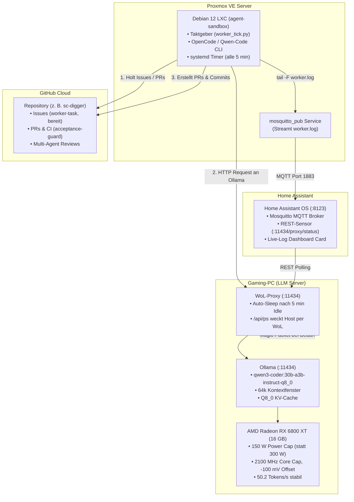

# 🤖 Agent-Sandbox-Infra

> **Autonome, isolierte Multi-Agenten-Entwicklungsumgebung mit Proxmox LXC, On-Demand Wake-on-LAN LLM-Server, hocheffizientem AMD RDNA2 GPU-Tuning und Home Assistant Live-Telemetrie.**

---

## 🏛️ Architektur-Übersicht



---

## 📁 Repository-Struktur

| Verzeichnis | Beschreibung |
|---|---|
| [`proxmox/`](proxmox/) | Shell-Skripte zur Erstellung des unprivilegierten Debian 12 LXC-Containers auf Proxmox VE. |
| [`sandbox/`](sandbox/) | Setup-Skripte (`install.sh`), der autonome Taktgeber (`worker_tick.py`) und systemd-Units (`qwen-worker`, `qwen-mqtt`). |
| [`hardware/`](hardware/) | GPU-Hardware-Tuning für AMD RDNA2 (150W Cap, LACT, Undervolting) und Ollama-Service Overrides. |
| [`homeassistant/`](homeassistant/) | YAML-Konfigurationen für REST- und MQTT-Sensoren sowie die Lovelace-Dashboard-Karte. |
| [`tests/`](tests/) | Unit-Tests für den Taktgeber (`test_worker_tick.py`), läuft ohne Netzwerk mit Mocks. |

---

## 🚀 Schnelleinrichtung in 4 Schritten

### 1. Hardware & Ollama vorbereiten (LLM-Host)
* Kernel-Overdrive freischalten: `amdgpu.ppfeaturemask=0xffffffff` im Bootloader eintragen.
* Power-Cap auf 150 W, Core auf 2100 MHz und Voltage-Offset auf -100 mV begrenzen (Details in [`hardware/amd-rdna2-tuning.md`](hardware/amd-rdna2-tuning.md)).
* Ollama mit `OLLAMA_KV_CACHE_TYPE=q8_0` konfigurieren (Achtung: `OLLAMA_FLASH_ATTENTION=1` auf RDNA2 deaktiviert lassen!).

### 2. Sandbox auf Proxmox anlegen
Auf dem Proxmox VE Host:
```bash
curl -fsSLO https://raw.githubusercontent.com/tripitest-art/agent-sandbox-infra/main/proxmox/host-create.sh
CTID=$(pvesh get /cluster/nextid) bash host-create.sh
```

### 3. SSH-Schlüssel & GitHub-Token hinterlegen
* SSH-Zugang für Steuerungs-Agenten in den Container eintragen (siehe [`proxmox/README.md`](proxmox/README.md)).
* Im Container per `gh auth login --with-token` einen feingranularen Token hinterlegen.
* Den Taktgeber-Timer scharfschalten: `systemctl enable --now qwen-worker.timer`.

### 4. Modell-Backend & Home Assistant anbinden
* Standard ist `BACKEND=litellm`: Der Worker nutzt den Alias `coder` (DeepSeek) über den
  LiteLLM-Proxy (LXC 113, `http://192.168.0.211:4000`) mit eigenem Virtual Key und Tagesbudget.
  `BACKEND=ollama bash sandbox/install.sh` schaltet zurück auf Qwen3-Coder am Gaming-PC.
* MQTT-User `LLM` im Home Assistant anlegen (siehe [`homeassistant/README.md`](homeassistant/README.md)).
* `bash sandbox/install.sh` im Container fragt fehlende Geheimnisse verdeckt ab
  (LiteLLM-Key → `/etc/qwen-worker.env`, MQTT-Passwort → `/etc/qwen-mqtt.env`, beide 600)
  und richtet `qwen-mqtt.service` ein. **Keine Geheimnisse ins Repo** – es ist öffentlich.
* YAML-Snippets aus [`homeassistant/`](homeassistant/) in die `configuration.yaml` und das Dashboard einfügen.

---

## 🛡️ Multi-Agent Governance & Sicherheitsregeln

1. **GitHub `main` ist die einzige Wahrheit:** Agenten arbeiten strikt auf Feature-Branches; Merges erfolgen nur über Pull Requests mit bestandenen CI-Checks.
2. **Keine gleichen Familien beim Review:** Wenn ein Modell aus der Qwen-Familie den Code umsetzt, prüft ein Modell aus der Gemini- oder Claude-Familie den Pull Request (und umgekehrt).
3. **Vertragstreue durch den `acceptance-guard`:** Der Akzeptanztest aus dem GitHub-Issue wird zeichengenau als erster Commit gesichert. Der `acceptance-guard` verhindert, dass der Worker-Agent Tests nachträglich abschwächt oder anpasst.
4. **Schreibschutz & Sandbox-Isolation:** Der Container ist unprivilegiert und hat keinerlei Lese- oder Schreibrechte auf sensible Netzlaufwerke oder das Hypervisor-System.
