# 🤖 Agent-Sandbox-Infra

> **Autonome Multi-Agenten-Infrastruktur mit Proxmox LXC, isolierten parallelen Worker-Slots, automatischem Review- und Merge-Takt, LiteLLM-Budgetüberwachung, On-Demand WoL LLM-Host und Home Assistant Live-Telemetrie.**

---

## 🏛️ Architektur-Übersicht

```mermaid
flowchart TD
    subgraph GitHub["GitHub Cloud (Multi-Projekt)"]
        REPO["Repositories (sc-digger, agent-sandbox-infra, ...)<br>• Issues (worker-task, bereit)<br>• PRs & CI (acceptance-guard, pytest, CodeQL)<br>• Multi-Agent Governance & Squash-Merge"]
    end

    subgraph Proxmox["Proxmox VE Server"]
        subgraph CT112["Debian 12 LXC (CT 112: agent-sandbox)"]
            W1["Worker Slot 1 (w1)<br>worker_tick.py"]
            W2["Worker Slot 2 (w2)<br>worker_tick.py"]
            REV["Review-Takt (alle 2 min)<br>review_tick.py (GLM via LiteLLM)"]
            WH["qwen-webhook Service<br>(Live-Log & Slot-Telemetrie)"]
            HS["ha-status Timer (alle 2 min)<br>(Projekt-Matrix & LiteLLM-Budgets)"]
        end

        subgraph LXC113["Debian 12 LXC (CT 113: LiteLLM Proxy)"]
            LLM_PROXY["LiteLLM Proxy (:4000)<br>• coder (DeepSeek V3/V4)<br>• coder-glm (GLM 5.3 Flash)<br>• Fallbacks (coder-or, coder-free)<br>• Virtual Keys & Budget-Tracking"]
        end
    end

    subgraph LLM_Host["Lokaler Gaming-PC (Optionaler LLM Host)"]
        WOL_PROXY["WoL-Proxy (:11434)<br>• Auto-Sleep nach 5 min Idle<br>• On-Demand Wake-on-LAN"]
        OLLAMA["Ollama (:11434)<br>• qwen3-coder-64k (30B MoE, Q4_K_M)<br>• AMD RX 6800 XT (LACT, 2100 MHz, -90 mV)"]
        WOL_PROXY --> OLLAMA
    end

    subgraph SmartHome["Home Assistant (:8123)"]
        HA["Home Assistant OS<br>• Dashboard 'KI Cloud' (system-llm-cloud)<br>• Mushroom Live-Slot-Karten (w1, w2)<br>• Multi-Projekt Matrix & 'Braucht Stephan'-Alerts<br>• Prime-Time Kachel, Budget-Trends & Live-Log"]
    end

    subgraph MusicServer["Musik-Server (LXC 107)"]
        DEPLOY["Auto-Deploy Pull-Timer<br>• sc_digger/autodeploy.py (alle 5-15 min)<br>• ./update.sh (Docker Build & Rauchtest)<br>• Autonomer Rollback bei Fehlschlag"]
    end

    W1 & W2 -->|1. Holt Aufgaben & setzt um| REPO
    W1 & W2 -->|2. Code-Generierung via LiteLLM| LLM_PROXY
    W1 & W2 -.->|Alternativ: Lokales Backend| WOL_PROXY
    W1 & W2 -->|3. Erstellt PRs mit Akzeptanztests| REPO

    REV -->|4. Prüft PRs, urteilt unabhängig| REPO
    REV -->|5. Auto-Merge & Entblocken| REPO
    REV -->|Auswertung via| LLM_PROXY

    WH & HS -->|6. JSON Webhook Telemetrie| HA
    HA -.->|Push bei 'braucht-stephan' / Heartbeat-Ausfall| SmartHome

    REPO -->|7. Auto-Deploy via Read-Only Pull| DEPLOY
```



---

## 🚀 Die 5 Ausbaustufen (Roadmap-Status)

Details und Verträge: [`ROADMAP.md`](ROADMAP.md).

| Stufe | Bezeichnung | Status | Kernmerkmale |
|:---:|---|:---:|---|
| **1** | **Autonomer Auto-Merge & Entblockierung** | ✅ **Live** | `review_tick.py` mergt PRs nach unabhängigem Freigabe-Urteil und grünem CI autonom per Squash-Merge (`gh pr merge --squash`); entblockt Folge-Issues (`Wartet auf: #X, #Y`). |
| **2** | **Strukturierte Slot-Telemetrie & HA-Dashboard** | ✅ **Live** ([#14](https://github.com/tripitest-art/agent-sandbox-infra/issues/14), PR [#48](https://github.com/tripitest-art/agent-sandbox-infra/pull/48)) | Atomare Statusdateien (`slot-1.json`, `slot-2.json`) in `/run/worker-slots/`, PID-Überwachung (Dead-PID Detection), reaktiver Webhook-Stream und Mushroom-Karten mit Live-Task, Modell, Laufzeit-Timer und GitHub-Direktlinks. |
| **3** | **Continuous Deployment (Pull-Timer auf CT 112)** | ✅ **Live** ([#15](https://github.com/tripitest-art/agent-sandbox-infra/issues/15)) | `autodeploy.py` prüft alle 15 Minuten `origin/main`, testet einen neuen Stand mit pytest, rollt ihn per `install.sh` aus und setzt bei Fehlern automatisch auf den letzten laufenden Stand zurück. Wartet, solange Worker oder Review arbeiten. Aus, bis `AUTODEPLOY=1` gesetzt ist; Betrieb: [`docs/autodeploy.md`](docs/autodeploy.md). |
| **4** | **Prime-Time & Kosten-intelligentes Scheduling** | ⏳ **Geplant** ([#16](https://github.com/tripitest-art/agent-sandbox-infra/issues/16)) | Dynamisches Umschalten von LiteLLM-Modellen anhand von DeepSeek Prime-Time Tarifen (Peak 1,20 $/1M vs. Off-Peak 0,60 $/1M), automatische Drosselung bei Budgetannäherung. |
| **5** | **Planer-Beschleunigung (AI Issue Pre-Flight)** | ⏳ **Geplant** ([#17](https://github.com/tripitest-art/agent-sandbox-infra/issues/17)) | Automatisierte Akzeptanztest-Validierung (Rot-Prüfung vor Issue-Freigabe), automatische Hotspot- und Abhängigkeitserkennung für den Planer. |

---

## 📁 Repository-Struktur

| Verzeichnis | Beschreibung |
|---|---|
| [`ROADMAP.md`](ROADMAP.md) | Roadmap und 5-Stufen-Optimierungsplan für den autonomen Multi-Agenten-Workflow. |
| [`CHANGELOG.md`](CHANGELOG.md) | Was seit dem letzten Deploy neu ist; eine Zeile pro Pull Request. |
| [`AGENTS.md`](AGENTS.md) | Verbindliche Einweisung und Governance-Regeln für alle KI-Agenten (Planer, Worker, Reviewer). |
| [`SECURITY.md`](SECURITY.md) | Meldeweg für Sicherheitslücken: GitHub „Private vulnerability reporting“; keine Zugangsdaten in öffentliche Issues. |
| [`LICENSE`](LICENSE) | MIT-Lizenz, Copyright (c) 2026 Stephan Voigt. |
| [`docs/`](docs/) | Vertiefende Dokumentation: [`planer-ablauf.md`](docs/planer-ablauf.md), [`mcp.md`](docs/mcp.md), [`mehrere-projekte.md`](docs/mehrere-projekte.md), [`backup.md`](docs/backup.md), [`autodeploy.md`](docs/autodeploy.md), [`betriebsbericht-2026-10-15.md`](docs/betriebsbericht-2026-10-15.md), GitHub Ruleset [`main-schutz.ruleset.json`](docs/main-schutz.ruleset.json). |
| [`skills/`](skills/) | Agenten-Skills für dieses Projekt (`agent-sandbox-review`). |
| [`.github/`](.github/) | CI (`tests`, `acceptance-guard`), Issue- und PR-Vorlagen. Änderungen hier braucht Stephans Freigabe (`freigabe-geschützt`). |
| [`sandbox/`](sandbox/) | Steuerungslogik: Setup (`install.sh`, `install-lib.sh`), Worker-Takt (`worker_tick.py`), Review-Takt (`review_tick.py`), Multi-Projektverwaltung (`projects.py`), Webhook-Daemon (`qwen_webhook.py`), Status-Reporter (`ha_status.py`), Auto-Deploy (`autodeploy.py`, Timer `agent-sandbox-deploy` über `AUTODEPLOY=1`), Web-Dashboard (`dashboard.py`, Push-Meldungen in `dashboard_notify.py`, nur lesend, nur LAN, Dienst `agent-dashboard` über `DASHBOARD=1`) Wake-Listener (`wake_listener.py`, Dienst `agent-wake`) und systemd-Units (`sandbox/systemd/`). |
| [`proxmox/`](proxmox/) | Host-Skripte zur Erstellung des unprivilegierten Debian 12 LXC-Containers auf Proxmox VE (`host-create.sh`). |
| [`hardware/`](hardware/) | AMD RDNA2 GPU-Tuning für den lokalen LLM-Host (LACT, 2100 MHz, −90 mV, 255 W) mit Benchmarks und Ollama-Overrides. |
| [`homeassistant/`](homeassistant/) | YAML-Konfigurationen: REST- und Webhook-Sensoren (`configuration_sensors.yaml`), Lovelace Dashboard-Karten (`dashboard_card.yaml`) und Benachrichtigungs-Automationen. |
| [`tests/`](tests/) | Testsuite für Worker-, Review- und Webhook-Logik, Multi-Projekte und `acceptance_guard.py` (ohne Netzwerk mit Mocks). |

---

## ⚙️ Funktionsweise im Detail

### 1. Parallele Worker-Slots & Regel-8-Schutz
- **Worktree-Isolation:** Mit `MAX_WORKERS=2` arbeitet jeder Slot in einem komplett isolierten Verzeichnis (z. B. `/root/sc-digger-worktrees/w1` und `/root/sc-digger-worktrees/w2`).
- **Dateikollisionsschutz (Regel 8):** Der Taktgeber liest vor Auftragsannahme alle aktiven Aufgaben. Hat ein Issue Überschneidungen in `### Betroffene Dateien` mit einer bereits laufenden Aufgabe oder berührt die Sperrdatei (`hotspot`, z. B. `sc_digger/main.py`), wird es übersprungen, bis der andere Slot fertig ist.
- **Modell-Fallback:** Vor jedem Lauf prüft der Worker mit einem Mini-Probe-Call das primäre Modell (`coder`, DeepSeek). Antwortet es nicht innerhalb des Timeouts, weicht er automatisch auf konfiguierte Alternativen aus (`coder-or` via OpenRouter, `coder-free` via Codestral).
- **Tagesbudget des Worker-Keys (`key_info`/`budget_problem`):** Vor der Modellprobe liest der Takt `GET {LITELLM}/key/info` mit dem eigenen Schlüssel. Ist das Budget aufgebraucht (`spend >= max_budget`), beantwortet LiteLLM auch die Ausweichmodelle mit 429 – der Takt wartet dann, ohne einen Versuch zu verbrauchen, und läuft nach dem Reset von selbst weiter; die Zeile nennt nur den Reset-Zeitpunkt, keine Budgetwerte. Eine unklare Lage (keine Antwort, kein Limit, keine Zahlen) hält den Takt nicht an.
- **Push-Sperre (`pre-push`-Hook):** Vor jedem Agentenlauf schreibt `worker_tick.py` einen `pre-push`-Hook in den Klon des Slots (`ensure_pre_push_hook`, Ordner von `git rev-parse --git-path hooks`). Er führt `TEST_CMD` aus und lehnt den Push bei roten Tests ab. Nur die Eskalation mit Draft-PR darf `git push --no-verify` nutzen; der Auftrag sagt das ausdrücklich. Scheitert das Setzen des Hooks, startet der Lauf nicht (Meldung `⚠ Stephan:`).
- **Audit-Log (`AUDIT_LOG`, Vorgabe `/root/audit.jsonl`; #85):** `worker_tick.py` hängt je Ereignis eine JSON-Zeile an — Zeitstempel in UTC, `event`, Slot, Modell und die übergebenen Felder — damit sich Takte maschinell auswerten lassen, ohne den Fließtext in `/root/worker.log` zu parsen. Den Anfang macht die Übernahme eines Issues (`issue_claimed`, Funktion `audit()`); Felder wie `token`, `api_key` oder `authorization` stehen nur als `***` drin (Regel 5). Schreibfehler brechen den Lauf nicht ab, sondern kommen als `Audit-Log nicht schreibbar: <Fehlerklasse>` ins Log.

### 2. Autonomer Review-Takt & Auto-Merge
- `review_tick.py` läuft alle 2 Minuten als unabhängiger systemd-Timer (`REVIEW_TAKT`); ein Modellaufruf entsteht nur für einen neuen Commit.
- **Sofort-Start statt Warten:** `.github/workflows/wake.yml` schickt bei Label `bereit`, PR-Ereignissen und fertigen Checks das Wort „wake“ an einen ntfy-Strom (GitHub-Secret `WAKE_PUBLISH_URL`, Inhalt und Thema nie im Repo). Der Dienst `agent-wake` auf dem Server hört dort ausgehend mit und startet die Takt-Units sofort (Teil 1: #128). Die Timer bleiben als Sicherheitsnetz.
- **Unabhängiges Modell:** Reviews werden mit `coder-glm` (GLM 5.3 Flash) oder bei großen Diffs mit `longctx-lite` (Gemini 3.5 Flash-Lite) durchgeführt – strikt getrennt von der Worker-Modellfamilie.
- **Automatischer Merge:** Bei Urteil `**Freigegeben**`, bestandenen Pflicht-Checks (`tests`, `acceptance-guard`, `CodeQL`) und `### Merge-Modus: automatisch` führt das Skript den Squash-Merge eigenständig durch.
- **PRs ohne Worker-Issue (Label `review-anfordern`):** Normalerweise nimmt der Takt nur PRs von `feature/issue-<N>`, deren Issue ein Worker-Label trägt. Ein von Hand oder mit Claude/Antigravity angelegter PR (z. B. `feature/dashboard-*`) wird trotzdem geprüft, sobald jemand mit Schreibrecht am Repository das Label `review-anfordern` setzt (`REVIEW_REQUEST_LABEL`); das Review läuft unverändert (Familienregel, Pflicht-Checks, Runden, Status `review`). Gibt es kein zugehöriges Worker-Issue, prüft der Takt gegen PR-Text und Regeln, und einen Merge gibt es nie: der PR liegt nach dem Review bei Stephan. Der Takt setzt oder entfernt das Label selbst nie, und Fork- sowie Draft-PRs bleiben ausgeschlossen.
- **Automatisches Entblocken:** Nach jedem Merge prüft das Skript alle blockierten Issues. Sind alle Bedingungen in `Wartet auf: #X, #Y` erfüllt, wird das Issue automatisch auf `bereit` umgestellt.

### 3. Multi-Projekt-Unterstützung (`/etc/agent-projects.json`)
Die Sandbox betreut mehrere Repositories parallel. In `/etc/agent-projects.json` (Vorlage: [`sandbox/projects.example.json`](sandbox/projects.example.json)) werden Projekte mit Kurzname, GitHub-Repo, lokalem Klon-Pfad und Hotspot-Regeln hinterlegt. Jeder Worker-Slot nimmt die nächste fällige Arbeit aus dem gemeinsamen Pool nach Priorität.

---

## 🚀 Schnelleinrichtung in 4 Schritten

### 1. Sandbox auf Proxmox anlegen
Auf dem Proxmox VE Host:
```bash
CTID=$(pvesh get /cluster/nextid) bash proxmox/host-create.sh
```

### 2. GitHub-Zugang hinterlegen
Im Container CT 112:
- Per `gh auth login --with-token` einen feingranularen GitHub Personal Access Token (PAT) hinterlegen (mit Rechten für Issues, Pull Requests und Workflows im Arbeits-Repository).
- `install.sh` erzeugt bei Bedarf einen lesenden Deploy-Key (`/root/.ssh/agent_infra_deploy`).

### 3. Installation & Konfiguration ausführen
```bash
cd /root/agent-sandbox-infra
bash sandbox/install.sh
```
Das Skript fragt fehlende Geheimnisse verdeckt ab (LiteLLM-Key → `/etc/qwen-worker.env`, Reviewer-Key → `/etc/qwen-reviewer.env`, Webhook-URL → `/etc/qwen-webhook.env`, Status-Webhook-URL → `/etc/ha-status.env`, ntfy-URL für den Wake-Listener → `/etc/agent-wake.env`, alle Rechte `0600`) und richtet die systemd-Dienste ein:
- Einstellungen wie `MAX_WORKERS=2`, `REVIEW_POST=1` und `REVIEW_AUTO_MERGE=1` werden dauerhaft in `/etc/agent-sandbox.conf` gespeichert.
- Ressourcenlimits je Worker-Slot: `SLOT_MEMORY_MAX` (z. B. `1200M`), `SLOT_TASKS_MAX` (z. B. `512`) und `SLOT_CPU_PERCENT` (z. B. `150`) landen als `MemoryMax`, `TasksMax` und `CPUQuota` in `qwen-worker@.service` und werden ebenfalls gemerkt. Leer oder `none` heißt kein Limit (so ist es ohne Angabe; ein bestehender Betrieb ändert sich nicht). Ungültige Werte brechen das Skript vor dem Merken ab. Beispiel: `SLOT_MEMORY_MAX=1500M SLOT_TASKS_MAX=256 SLOT_CPU_PERCENT=200 bash sandbox/install.sh`. Gemessen am 16.10.2026 (CT 112, 2 Slots, gut eine Woche Betrieb, aus den cgroup-Dateien von `system-qwen-worker.slice`): Speicherspitze beider Slots zusammen 2704 MiB, davon fast alles Seitencache (aktuell fast kein anonymer Speicher), höchstens 70 Prozesse gleichzeitig, kein Swap. Daraus der Vorschlag für den 4-GB-Container bei 2 Slots: `1500M`, `256`, `200` (Summe 3000M, damit Review, Webhook und System noch Platz haben); bei mehr Slots die Speichergrenze senken. Ein vom Limit beendeter Lauf steht im `journalctl`, nicht als „⚠ Stephan:“-Zeile in `worker.log`.
- Der Timer `ha-status.timer` startet `sandbox/ha_status.py` alle 2 Minuten über einen `ha-status.service` und meldet den Projektstand an die Webhook aus `HA_STATUS_URL` (in `/etc/ha-status.env`). Fehlt die URL, bleibt der Timer aus; Worker- und Review-Takt laufen davon unabhängig.
- Der Timer `agent-sandbox-deploy.timer` startet alle 15 Minuten `sandbox/autodeploy.py` (Auto-Deploy von `origin/main`, mit Pre-Flight-Test und Rollback). Er ist aus, bis `AUTODEPLOY=1 bash sandbox/install.sh` läuft; die Einstellung merkt sich `/etc/agent-sandbox.conf`. Ablauf und Betrieb: [`docs/autodeploy.md`](docs/autodeploy.md).
- Der Dienst `agent-dashboard.service` startet das Web-Dashboard `sandbox/dashboard.py` (nur lesend, ohne Login). Er ist aus, bis `DASHBOARD=1 bash sandbox/install.sh` läuft; `DASHBOARD` und `DASHBOARD_PORT` (Standard 8099) merkt sich `/etc/agent-sandbox.conf`. Die Seite zeigt Slots, Projekt-Matrix, „braucht Stephan“, LiteLLM-Budgets und das Live-Log. Budgets liest er aus `/etc/ha-status.env` und `/etc/qwen-reviewer.env` (wie `ha-status`). Die Limits (`max_budget`) lassen sich dort ändern, wenn `/etc/agent-dashboard.env` (600) `LITELLM_MASTER_KEY` und `DASHBOARD_WRITE_TOKEN` (mind. 16 Zeichen) enthält; `install.sh` fragt beides ab, leer lassen heißt „nur lesen“. Geändert wird nur `max_budget`, jede Änderung steht im Journal des Dienstes. Push-Meldungen kommen über ntfy, wenn `NTFY_URL` (volle URL samt geheimem Topic, optional `NTFY_TOKEN`) in `/etc/agent-dashboard.env` steht: bei neuen `⚠ Stephan`-Zeilen, totem Slot-Prozess, Budget ab 90 % (einmal je Key und Tag) und über 10 Minuten veralteten Daten. Test: `python /root/dashboard.py --notify-test`. Eine selbst gehostete ntfy-Instanz im LAN braucht eine `OUT ACCEPT`-Regel in der Proxmox-Firewall von CT 112; `ntfy.sh` im Internet geht ohne. Die HA-Automation `automation_stephan.yaml` meldet dasselbe doppelt, schalte sie ab, sobald ntfy läuft. Das Lesen hat keinen Login: nur im LAN erreichbar machen, nie per Portfreigabe, und vor Caddy `basic_auth` setzen.
- Der Dienst `agent-wake.service` startet den Wake-Listener `sandbox/wake_listener.py`. Er hält eine ausgehende Verbindung zu einem ntfy-Thema (`WAKE_URL` in `/etc/agent-wake.env`), um bei GitHub-Ereignissen (z. B. neues Issue `bereit`, PR-Aktualisierung, beendete Checks) die Takt-Units sofort per `systemctl start --no-block` anzustoßen. Die periodischen Timer (`qwen-worker.timer`, `qwen-review.timer`) bleiben als Sicherheitsnetz für verpasste Signale oder netzwerklose Phasen unverändert bestehen. Fehlt `WAKE_URL`, bleibt der Dienst deaktiviert (`disable --now`) und die Sandbox arbeitet wie bisher rein timerbasiert.

### 4. Home Assistant anbinden
1. Webhook-IDs in Home Assistant `secrets.yaml` hinterlegen.
2. YAML-Snippets aus [`homeassistant/configuration_sensors.yaml`](homeassistant/configuration_sensors.yaml) in Home Assistant einfügen (`template.reload`).
3. Dashboard-Karten aus [`homeassistant/dashboard_card.yaml`](homeassistant/dashboard_card.yaml) in das Lovelace-Dashboard (z. B. View `system-llm-cloud`) einbinden.

---

## 🛡️ Multi-Agent Governance & Sicherheitsregeln

1. **GitHub `main` ist die einzige Wahrheit:** Agenten arbeiten strikt auf Feature-Branches; Merges erfolgen nur über Pull Requests mit bestandenen Pflicht-Checks (`tests`, `acceptance-guard`, `CodeQL`).
2. **Keine gleichen Familien beim Review:** Wenn ein Modell aus der DeepSeek/Qwen-Familie den Code umsetzt, prüft ein Modell aus der GLM-, Gemini- oder Claude-Familie den Pull Request (und umgekehrt).
3. **Vertragstreue durch den `acceptance-guard`:** Der Akzeptanztest aus dem GitHub-Issue wird zeichengenau als erster Commit gesichert. Der `acceptance-guard` verhindert serverseitig in der CI, dass ein Worker Tests abschwächt, überspringt oder verändert.
4. **Schreibschutz & Sandbox-Isolation:** Der Container ist unprivilegiert und besitzt keinerlei Schreibrechte auf Netzlaufwerke, Hypervisor oder den Musik-Server. Deployments erfolgen ausschließlich entkoppelt per Pull.
5. **Keine Secrets im Repository:** Webhook-IDs, API-Keys und Token liegen ausschließlich in `/etc/*.env` (chmod 600) auf dem Server und erscheinen niemals in Logs, Chat oder Code.

---

## ⚖️ Lizenz und Sicherheit

- **Lizenz:** MIT, Copyright (c) 2026 Stephan Voigt. Was andere mit dem Code tun dürfen, steht in [`LICENSE`](LICENSE); ohne diese Datei gälte „alle Rechte vorbehalten“.
- **Sicherheitslücken melden:** [`SECURITY.md`](SECURITY.md) nennt den vertraulichen Weg über GitHub „Private vulnerability reporting“ (`security/advisories/new`) und was in einem Bericht nicht stehen darf. Keine Zugangsdaten und keine Details in öffentliche Issues (Regel 5 in [`AGENTS.md`](AGENTS.md)).
