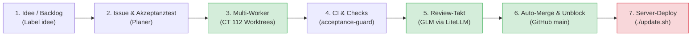

# 🚀 Roadmap & Optimierungsplan: Autonomer Multi-Agenten-Workflow

Dieses Dokument beschreibt die Gesamtarchitektur und Entwicklungs-Roadmap für die autonome Multi-Agenten-Infrastruktur (`agent-sandbox-infra`). Ziel ist eine vollständig entkoppelte, fehlertolerante und transparente Pipeline: von der Issue-Planung über isolierte parallele Worker-Slots bis hin zum automatischen Review, Merge und Server-Deployment.

---

## 1. Übersicht der Wertschöpfungskette



* **Grün:** Bereits vollständig autonom implementiert und im Live-Einsatz.
* **Rot:** Aktuell noch manueller Zwischenschritt (Deployment auf dem Produktiv-Server).

---

## 2. Die 5 Optimierungsstufen im Detail

---

### ✅ Stufe 1: Autonomer Auto-Merge & Entblockierungs-Kette (Abgeschlossen)

Umgesetzt in PR [#11](https://github.com/tripitest-art/agent-sandbox-infra/pull/11) und verfeinert in PR [#12](https://github.com/tripitest-art/agent-sandbox-infra/pull/12).

#### Funktionsweise:
1. **Auto-Merge bei grünem Urteil:**
   Sobald `review_tick.py` das Urteil `**Freigegeben**` fällt, alle Pflicht-Checks (`tests`, `acceptance-guard`, `CodeQL`) grün sind und im Issue `### Merge-Modus: automatisch` steht, führt das Skript autonom den Squash-Merge aus:
   ```bash
   gh pr merge <PR> --squash
   ```
2. **Automatisches Entblocken (`Wartet auf: #N`):**
   Direkt nach erfolgreichem Merge sowie bei jedem periodischen Review-Takt prüft das Skript alle offenen Issues mit dem Label `blockiert`. Sind alle in der Zeile `Wartet auf:` genannten Abhängigkeiten (PRs oder Issues) geschlossen oder gemergt, tauscht das Skript automatisch:
   `blockiert` $\rightarrow$ `bereit` (`gh issue edit <N> --add-label bereit --remove-label blockiert`).
3. **Schutzmechanismen & Governance:**
   - Bei `### Merge-Modus: manuell` im Issue erfolgt niemals ein automatischer Merge; der PR verbleibt zur Freigabe bei Stephan.
   - Bei `REVIEW_POST=0` (Entwurfsmodus) wird weder gemergt noch umgelabelt.
   - Steuerung über `REVIEW_AUTO_MERGE=1` (Default: aktiv).

---

### ✅ Stufe 2: Strukturierte Slot-Telemetrie & Web-Dashboard (Abgeschlossen)

Umgesetzt in PR [#48](https://github.com/tripitest-art/agent-sandbox-infra/pull/48) und erweitert in PR [#114](https://github.com/tripitest-art/agent-sandbox-infra/pull/114), [#151](https://github.com/tripitest-art/agent-sandbox-infra/pull/155) und [#158](https://github.com/tripitest-art/agent-sandbox-infra/pull/158).

Ziel war es, für die parallelen Worker-Slots strukturierte Telemetrie, ein autarkes Web-Dashboard sowie zuverlässige Push-Meldungen bereitzustellen.

#### Kernpunkte:
1. **JSON-Payload mit strukturiertem Slot-Status:**
   `worker_tick.py` pflegt atomare Statusdateien (`slot-1.json`, `slot-2.json`) unter `/run/worker-slots/` oder `/root/worker-slots/`. Das Dashboard liest diese aus und zeigt Zustandsänderungen sowie tote Prozesse strukturiert an:
   ```json
   {
     "slots": {
       "1": {
         "status": "running",
         "issue": 220,
         "title": "Live-Dashboard API",
         "model": "coder",
         "agent": "Qwen Code mit DeepSeek",
         "started_at": "17:20:00"
       },
       "2": {
         "status": "idle",
         "message": "Warte auf nächsten Takt"
       }
     }
   }
   ```
2. **Autarkes Web-Dashboard (`dashboard.py`):**
   - Live-Slot-Karten (Task, Modell, Laufzeit, Projekt, Status)
   - Multi-Projekt-Matrix und „Wartet auf Stephan“-Übersicht
   - LiteLLM-Budget-Tracking und Review-Statistiken
3. **Push-Benachrichtigungen via ntfy (`dashboard_notify.py`):**
   - Push bei neuen „⚠ Stephan:“-Zeilen, toten Slot-Prozessen und Budgets ab 90 %

---

### ✅ Stufe 3: Continuous Deployment (Abgeschlossen)

Nach dem Merge in `main` muss derzeit auf dem Musik-Server manuell `/root/sc-digger && ./update.sh` ausgeführt werden. Ziel ist die vollständige Schließung der Bereitstellungskette.

#### Kernpunkte:
1. **Automatischer Deploy-Mechanismus:**
   - **Option A (Pull/Timer):** Ein leichtgewichtiger systemd-Timer auf dem Musik-Server prüft alle 15–30 Minuten `origin/main` auf neue Commits und führt bei Differenz `./update.sh` aus.
   - **Option B (Event/Webhook):** GitHub Actions oder ntfy triggern nach erfolgreichem Auto-Merge per Webhook das Update-Skript.
2. **Sicherheits-Leitplanken:**
   - Deploy erfolgt ausschließlich nach grünem CI und Squash-Merge auf `main`.
   - Bei Fehlschlag des Builds oder Neustarts erfolgt eine Benachrichtigung via Telegram (`health.py`).

---

### 🔵 Stufe 4: Prime-Time- & Kosten-intelligentes Scheduling

DeepSeek berechnet zu Spitzenzeiten (Mo–Fr) einen Aufschlag (1,20 \$ statt 0,60 \$ pro 1M Tokens). Gleichzeitig soll das konfigurierte Tagesbudget optimal ausgenutzt werden.

#### Kernpunkte:
1. **Peak-Vermeidung für ressourcenintensive Tasks:**
   - Zu Prime-Time-Fenstern weicht der Worker bevorzugt auf `coder-or` (OpenRouter, ohne Peak-Aufschlag) aus oder pausiert neue umfangreiche Aufgaben bis zum Off-Peak-Fenster.
   - Dringende Korrekturen oder kleine Nacharbeiten laufen unterbrechungsfrei weiter.
2. **Dynamischer Budget-Deckel:**
   - Nähert sich der Tagesverbrauch (`sensor.llm_kosten_worker_heute`) dem Limit (z. B. ab 0,85 \$ bei 1,00 \$ Budget), schaltet der Taktgeber automatisch auf kostenfreie Fallback-Modelle (`coder-free` = Codestral) um oder pausiert bis zum Mitternachts-Reset.

---

### 🔵 Stufe 5: Planer-Beschleunigung (AI Issue Pre-Flight)

Die meiste manuelle Vorbereitungszeit fließt in das Ausformulieren präziser Schnittstellen und Akzeptanztests, die den strengen Vorgaben des `acceptance-guard` genügen.

#### Kernpunkte:
1. **Lokales Pre-Flight Tooling (`scripts/issuecheck.py`):**
   - Prüft vor dem Einstellen eines Issues:
     - Ist der Akzeptanztest auf dem aktuellen `main` tatsächlich rot?
     - Werden ausschließlich erlaubte Module importiert (keine verbotenen Netzwerk- oder Dritt-Libraries)?
     - Läuft der Test ohne Zeit-/Zufallsabhängigkeiten und ohne `skip`/`xfail`?
     - Sind Pflichtüberschriften, Merge-Modus und Pfade vertragskonform?
2. **Planer-Skill & Vorlage:**
   - Skill `skills/agent-sandbox-planner/SKILL.md` für Antigravity / Claude, um aus Stichpunkten direkt vertragskonforme Issue-Texte gemäß `docs/planer-ablauf.md` zu generieren und per Pre-Flight abzusichern.

---

## 3. Priorisierungs- und Umsetzungsstatus

| Stufe | Feature | Nutzen | Status |
|---|---|---|:---:|
| **Stufe 1** | Auto-Merge & `Wartet auf:` Auto-Unblock | ⭐⭐⭐⭐⭐ | ✅ **Gemergt (#11, #12)** |
| **Stufe 2** | Strukturierte Slot-Telemetrie & Web-Dashboard | ⭐⭐⭐⭐ | ✅ **Gemergt (#48, #114)** |
| **Stufe 3** | Continuous Deployment (`autodeploy.py`, Pull-Timer auf CT 112) | ⭐⭐⭐⭐ | ✅ **Gemergt (#15)** |
| **Stufe 4** | Prime-Time- & Budget-Scheduling | ⭐⭐⭐ | 🔵 **Geplant** |
| **Stufe 5** | Planer-Beschleunigung & Issue-Preflight | ⭐⭐⭐ | 🟡 **In Umsetzung (#17)** |
| **Baustein** | Web-Dashboard (`sandbox/dashboard.py`, Dienst `agent-dashboard`) | ⭐⭐⭐⭐ | ✅ **Gemergt (#104, #105, #114)**; Steuerbuttons, Merge-Statistik und Kosten pro Modell offen |
| **Baustein** | Mehrere Projekte (Projektliste, Infra-Repo als zweites Projekt) | ⭐⭐⭐⭐ | ✅ **Gemergt (#18, #19, #20)**; Inbetriebnahme auf dem Server: siehe [`docs/mehrere-projekte.md`](docs/mehrere-projekte.md) |

---

## 4. Backlog

Das Backlog sind Issues mit Label `idee` (ohne Akzeptanztest, ohne `bereit`), keine Datei: so gibt es
nur eine Quelle, die nicht auseinanderläuft. Offene Ideen: `gh issue list --label idee`. Der Planer
macht daraus ein Issue mit Vertrag (`docs/planer-ablauf.md`). Hier stehen nur die Stufen oben; ändert
sich ein Stand, wird diese Datei im selben PR angepasst.
